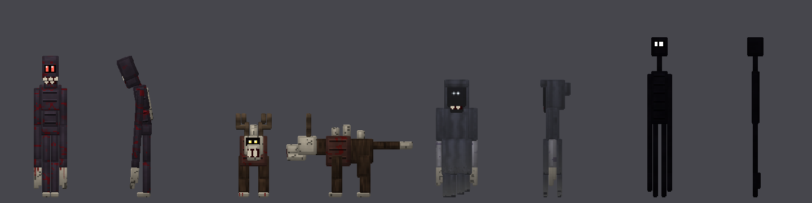
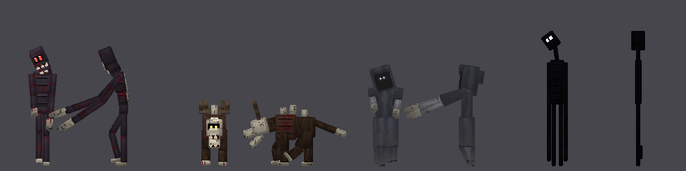

# Horror Stalkers v1.2 (Minecraft Bedrock addon)

Criaturas de terror que te acechan. / Stalking horror creatures.




| Criatura | Dónde aparece | Comportamiento |
|---|---|---|
| El Acechador (`horror:stalker`) | Superficie, luz baja | Se congela mientras lo miras y corre cuando apartas la vista. Si te alejas, se teletransporta detrás de ti. Su golpe provoca un susto (grito, oscuridad, náusea). |
| La Bestia del Bosque (`horror:woodbeast`) | Bosques, de noche | Cazador rápido con cráneo y astas. Huye de quien sostiene una antorcha o un farol, y se quema con el sol. |
| El Susurrante (`horror:whisperer`) | Cuevas oscuras | Invisible hasta que está a menos de 10 bloques. Flota, susurra, te envuelve en oscuridad y su golpe causa ceguera. |
| El Observador (`horror:watcher`) | De noche, a lo lejos | Nunca ataca. Te mira desde 30-40 bloques y desaparece si te acercas o le sostienes la mirada. |

**Noche de Sangre:** cada 7 noches cae una niebla roja, aparece un título en pantalla y
llegan muchos más cazadores.

**Modelos y animaciones:** modelos articulados (rodillas, codos, manos, mandíbula que se abre,
cola en tres segmentos, tiras de tela) con texturas HD procedurales: sombreado por cara,
venas, grietas en hueso, pliegues de tela, pelaje y sangre. Las animaciones se mezclan suavemente
entre caminar, reposo, caza (la mandíbula tiembla abierta, inclina la cabeza, extiende los brazos)
y ataque. Mientras miras al Acechador, se queda inmóvil como una estatua.

**Ambiente:** latido del corazón según la cercanía, pasos detrás de ti y sonidos lejanos.
Los ojos brillan en la oscuridad. Cada criatura tiene sus propios sonidos, animaciones
(espasmos, flotación, cola) y botín (perlas de ender, fragmento de eco, cuero, hueso,
membrana de phantom, saco de tinta brillante).

## Instalar
Abre `dist/HorrorStalkers.mcaddon` en Minecraft Bedrock 1.21+ (o renombra el `.zip` a
`.mcaddon`). Crea un mundo y activa ambos packs (BP y RP).

Para probar (con trucos activados):
```
/summon horror:stalker
/scriptevent horror:bloodnight     # empieza una Noche de Sangre ahora
/scriptevent horror:watcher        # hace aparecer un Observador cerca
```

## Desarrollo
```
python3 tools/generate_assets.py   # regenera JSON, modelos, texturas
python3 tools/build.py             # crea dist/HorrorStalkers.mcaddon y .zip
python3 tools/validate.py          # revisa JSON y referencias BP<->RP
node tools/smoke_test.mjs          # ejecuta los scripts con una API simulada
python3 tools/render_preview.py . docs/preview.png bind   # vista previa de los modelos
```
