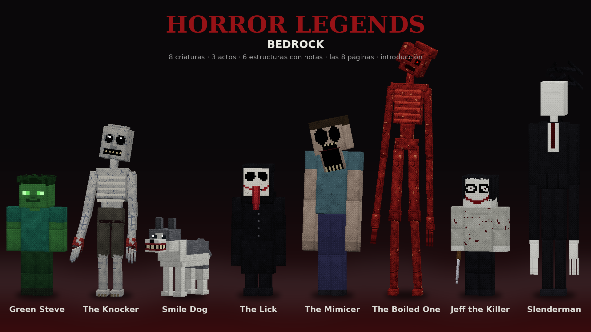

# Horror Legends: Bedrock — Add-On de terror para Minecraft Bedrock

> *Este mundo era tuyo. Ya no lo es.*

**Horror Legends: Bedrock** es un mod nuevo de la serie Horror Legends, distinto
de *Fears* y de *Help*. Es una historia de terror en **tres actos** con las
leyendas de Minecraft y las creepypastas clásicas, con **modelos, texturas y
animaciones nuevos**, **estructuras** que encuentras por el mundo, **notas con
la historia** de quien estuvo antes que tú y una **introducción** con cámara.

- **Green Steve**: «Green Steve se ha unido a la partida». «Voy para allá.»
- **The Knocker**: llama a tu puerta de noche y espera a que abras.
- **Smile Dog**: el husky de *smile.jpg*. DIFUNDE LA PALABRA.
- **The Lick**: de pie al fondo de las cuevas, entre cruces de piedra.
- **The Mimicer**: habla en el chat con tu nombre y te imita desde los árboles.
- **The Boiled One** (Doctor Nowhere): la emisora de números y el Fenómeno.
- **Jeff the Killer**: apaga las luces de tu casa. «Ve a dormir.»
- **Slenderman** y **las ocho páginas**.

Es un proyecto de fans: **no contiene código, arte ni sonido de otros mods**.
Los modelos, las texturas y los sonidos se generan por código en `tools/`, y
todo el comportamiento está escrito desde cero para Bedrock.

> ⚠️ **Suena fuerte.** Los sustos usan sonidos a volumen alto. Se puede bajar
> en el Diario → Ajustes → **Sonidos más fuertes** y **Sustos fuertes**.
>
> Usa sus propios identificadores (`hb:`), así que **no choca** con Fears ni con
> Help. Aun así, activar dos mods de terror a la vez en el mismo mundo es
> demasiado: elige uno por mundo.

## Instalación

- **Directo:** abre [`dist/HorrorBedrock.mcaddon`](dist/HorrorBedrock.mcaddon) con Minecraft.
- **Si el `.mcaddon` no se importa** (pasa en algunos móviles): abre los dos
  `.mcpack`, primero [`dist/HorrorBedrock_BP.mcpack`](dist/HorrorBedrock_BP.mcpack)
  (comportamiento) y luego [`dist/HorrorBedrock_RP.mcpack`](dist/HorrorBedrock_RP.mcpack)
  (recursos). Hacen falta los dos.
- **Por WhatsApp:** envía [`dist/HorrorBedrock_WhatsApp.zip`](dist/HorrorBedrock_WhatsApp.zip).
  Quien lo reciba **lo descomprime primero** (Minecraft no lee un `.zip`) y abre
  el `.mcaddon` de dentro, o los dos `.mcpack`.

Después, al crear o editar un mundo, activa **Horror Legends: Bedrock** en
*Packs de comportamiento* (el de recursos se añade solo). Requiere **Minecraft
Bedrock 1.21.0 o superior**. No necesita experimentos.

**Si Minecraft no lo detecta:**
- Mira la versión de Minecraft (abajo a la derecha en el menú): con una
  anterior a la **1.21.0** el pack no aparece o sale como no compatible.
- El pack está en *Packs de comportamiento*, en **Disponibles**: pulsa
  **Activar**. En *Ajustes → Almacenamiento* puedes comprobar si se importó.
- Si sale *"Error al importar"*, el archivo llegó dañado o sin descomprimir:
  vuelve a descargarlo y usa los `.mcpack`.

## La introducción

La primera vez que entras al mundo, la cámara se mueve sola: desde muy arriba,
desde lejos por el suelo, por encima de tu hombro y, al final, delante de tu
cara, mientras se cuenta la historia en pantalla. **Agáchate para saltarla.**
Al terminar recibes el **Diario**, una **linterna** y dos **pilas**. Se puede
volver a ver desde el Diario → Pruebas.

## La historia

Tres actos. Cada uno empieza al caer la noche y lo anuncia un título.

| Acto | Día (en Normal) | Qué llega |
|---|---|---|
| **I. Se ha unido a la partida** | 0–2 | sonidos, sustos, estructuras, Green Steve, The Knocker (día 1), Smile Dog (día 2) |
| **II. Los Otros** | 3–5 | The Lick (3), The Mimicer y The Boiled One (4), Jeff the Killer (5) |
| **III. Las Páginas** | 6+ | Slenderman y las ocho páginas |

Un **director** decide qué pasa según tu miedo y dónde estás (cueva, bosque,
casa, campo abierto, de noche): primero cosas pequeñas, luego la tensión sube y
llega un encuentro de verdad, y después te deja respirar.

### Las criaturas

- **Green Steve.** Sale en el chat que se ha unido a la partida, y luego «Voy
  para allá». Está en la puerta, detrás de ti o al borde de los árboles; cada
  vez que apartas la vista está más cerca. Si lo miras demasiado, o te
  alcanza: «Hola, hermano», el siseo de creepers a tu alrededor y una
  explosión que **duele pero no rompe bloques**. A veces solo se une y se va.
- **The Knocker.** Por la noche, si estás en casa, se pone fuera de la puerta
  más cercana y llama: tres golpes lentos, y otra vez. **Si abres la puerta,
  entra** y te persigue. Si no abres, al rato deja de llamar... y golpea una
  ventana. También aparece junto a tu cama cuando duermes.
- **Smile Dog.** Un husky sentado en la oscuridad. Si lo miras un segundo y
  medio: la foto, el flash, **DIFUNDE LA PALABRA** (también en el chat, con tu
  nombre) y se levanta a por ti. Si no lo miras, te sigue, siempre sentado.
  Se le puede matar.
- **The Lick.** Solo en cuevas. Al fondo, quieto, con **cruces de adoquín**
  en el suelo a su alrededor. Si te acercas a menos de 10 bloques, le das o le
  apuntas con la linterna, corre a por ti y trepa. **No se le puede herir**:
  sal de la cueva. Las cruces vuelven a ser piedra al rato.
- **The Mimicer.** Lejos, hablando: frases en el chat **con tu nombre** que tú
  no escribiste y voces de aldeano donde no hay aldeanos. Si lo miras mucho o
  te acercas, corre muy rápido y rompe lo que se le pone delante. **No sabe
  trepar**: sube tres bloques y se queda abajo mirándote, y se va.
- **The Boiled One.** Primero la **emisora de números** (una voz plana y
  dígitos rojos en pantalla). Luego, de pie muy lejos en el campo, cinco
  bloques de alto. **No lo mires**: tras tres segundos empieza el *Fenómeno*
  (pantalla roja, náusea, lentitud y daño) y a los siete te atrapa. También te
  mira dormir.
- **Jeff the Killer.** Entra en casas de noche: las antorchas se apagan una a
  una, alguien susurra «Ve a dormir» y está en la oscuridad, detrás de ti. Si
  lo ves, se ríe y te persigue con el cuchillo, abriendo puertas. **Se le
  puede matar.** Si duermes, al despertar está junto a la cama.
- **Slenderman.** Ver abajo. Fuera de su noche, a veces se le ve un momento
  entre los árboles.

**Al dormir:** The Knocker, Jeff y The Boiled One aprenden dónde duermes. Como
mucho una vez por noche, al acostarte la pantalla se oscurece y al despertar
hay alguien de pie junto a la cama.

### Las ocho páginas

En el Acto III, una noche llega la **niebla** y aparecen **ocho páginas
clavadas en troncos** a tu alrededor (hasta 40 bloques; donde no hay árboles,
se pone un poste). **Rómpelas** para arrancarlas. Tienes **8 minutos**.

- Tras la primera, aparece **Slenderman**. Cada vez que apartas la vista está
  más cerca, y más cerca cuantas más páginas tengas.
- Los **tambores** suenan más fuertes con cada página, luego estática y un
  zumbido grave.
- **Mirarle** trae estática que sube; si sigues mirando, duele. Si te alcanza
  o te mira demasiado: susto y daño fuerte, y se aleja.
- Si te alcanza la muerte o se acaba el tiempo, **las páginas se las lleva el
  viento** (se quitan solas, también los postes).
- **Con las ocho:** la niebla se levanta, te deja en paz **3 días** y recibes la
  **última nota**.

Mientras dura, no aparece ninguna otra criatura grande, pero los sustos
pequeños son el doble de probables.

### Estructuras y notas

Alguien estuvo en este mundo antes que tú. Con los días, a **40–60 bloques**,
donde no estabas mirando, aparece lo que construyó, y el chat te dice más o
menos dónde (distancia y dirección). Cada una tiene un **cofre con una nota**:

| Estructura | Día | Nota |
|---|---|---|
| Cabaña abandonada de abeto | 0 | 1 y 2 (Green Steve, The Knocker) |
| Perrera con huesos | 2 | 3 (Smile Dog) |
| Campo de cruces de piedra | 3 | 4 (The Lick) |
| Pequeño templo azul de lapislázuli | 4 | 5 (The Mimicer) |
| Antena de radio | 4 | 6 (The Boiled One) |
| Campamento con la hoguera apagada | 5 | 7 (Jeff, y las páginas) |
| — | — | 8: la recibes al encontrar las ocho páginas |

**Úsala** para leerla. El Diario → **Notas** guarda las que has leído.

## Objetos

- **Diario** (libro + carbón vegetal): la historia, las criaturas que has visto,
  las notas, los ajustes y las pruebas.
- **Linterna** (hierro, polvo de piedra luminosa, redstone): ilumina de verdad.
  Gasta **pilas** (redstone + pepita de hierro + lingote de cobre).
- **Farol Protector** (amatista + farol): nada aparece cerca de él.
- **Notas 1–8** y **páginas**.

## Ajustes (en el Diario)

- **Intensidad**: Baja, Normal, Alta o Pesadilla (cuándo llega cada cosa y cada
  cuánto pasa algo).
- Cada criatura, los sonidos, los sustos y las estructuras se pueden
  **desactivar** por separado.
- **Sustos fuertes**, **Sonidos más fuertes** y **Sonido 3D**.
- **Pruebas**: hacer aparecer cualquier criatura al momento, objetos y notas,
  ver la introducción o avanzar un día.

## Cómo se ha comprobado

No se ha probado dentro de Minecraft. Se ha comprobado con:

- un **simulador** de la API de scripts (`@minecraft/server`) con un mundo
  plano, cuevas, árboles y una puerta, donde se prueba cada criatura, la cama,
  las ocho páginas (ganar y perder), las seis estructuras con sus notas, la
  introducción y 40 minutos seguidos del director, con 5 semillas, sin errores;
- **TypeScript** contra los tipos oficiales de `@minecraft/server` 1.11.0;
- un validador propio (JSON, UUID, referencias, textos, sonidos, zips) y el
  diagnosticador de **Blockception** (sin errores ni avisos).

## Estructura

- `behavior_pack/scripts/` — `main.js`, `director.js`, `core/` (utilidades,
  registro de criaturas, sustos), `creatures/` (un archivo por criatura y
  `ruins.js` para las estructuras), `events/` (luces, sueño), `items/`
  (linterna, farol, notas), `ui/` (diario, introducción).
- `tools/` — genera todo: `build.py` (construye y empaqueta), `content.py`
  (entidades, objetos, bloques), `models/` (un modelo por criatura),
  `animations.py`, `sounds.py`, `lang.py` (todos los textos en español e
  inglés), `art.py`.

Para reconstruir: `cd tools && python3 -B build.py`.
