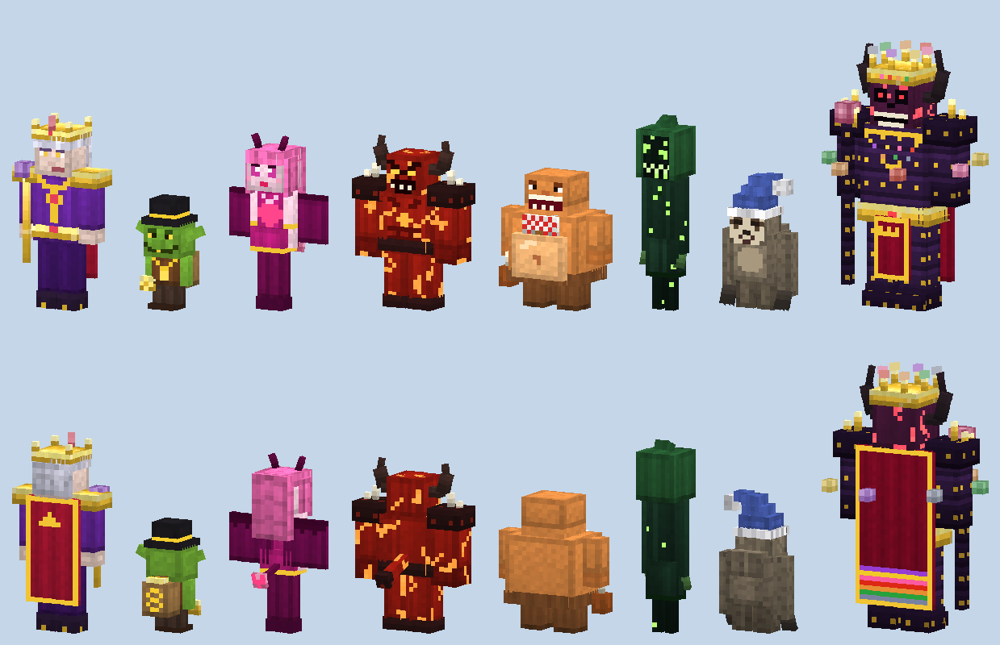

# Los 7 Pecados Capitales — Addon para Minecraft Bedrock



Siete criaturas hostiles nuevas, una por cada pecado capital. Cada una tiene su modelo, su textura,
sus poderes y su propio botín, incluida una **Esencia** que puedes beber para conseguir su poder.

## Instalación

1. Descarga `dist/LosSietePecados.mcaddon`.
2. Ábrelo en el dispositivo donde tengas Minecraft Bedrock (Windows, Android, iOS…). Minecraft
   importa solos los dos packs.
3. En los ajustes del mundo, activa el **Behavior Pack** «Los 7 Pecados Capitales (BP)». El
   Resource Pack se activa con él.
4. Necesitas Minecraft Bedrock **1.21.40 o superior**.

Para probarlos enseguida: `/summon pecados:envidium` (el jefe es `pecados:rey_pecados`), o usa los huevos de generación del inventario
creativo (Generar Envidium, Generar Lujurius…).

## Las criaturas

| Pecado | Criatura | Vida | Poderes |
|---|---|---|---|
| Soberbia | **Superbius** | 60 | Rey con corona de oro. Te lanza por los aires al golpearte, devuelve parte del daño que le haces y se regenera con poca vida. Casi inmune al empuje. |
| Avaricia | **Avaricity** | 18 | Duende muy rápido. Puede **robarte el objeto que tienes en la mano**; al matarlo suelta todo lo que robó. Da oro y esmeraldas. |
| Lujuria | **Lujurius** | 26 | Te atrae hacia ella con su hechizo; su golpe da náuseas y lentitud. |
| Ira | **Iratus** | 40 | Demonio con cuernos, inmune al fuego. Te prende fuego y entra en **furia** (fuerza y velocidad) por debajo de la mitad de vida. Aparece también en el Nether. |
| Gula | **Glotonix** | 50 | Gigante glotón: te da hambre, se cura al golpearte y **se come los objetos del suelo**. |
| Envidia | **Envidium** | 30 | Sombra de muchos ojos. Te debilita, roba tu fuerza, se **teletransporta a tu espalda** y se vuelve invisible. |
| Pereza | **Perezoth** | 60 | Lentísimo pero duro. Su aura de sopor te da lentitud y fatiga minera si te acercas. |

Aparecen de noche o en zonas oscuras, como cualquier monstruo. Superbius es el más raro.

## Esencias

Cada pecado puede soltar su Esencia (más probable con Botín). Bébela para obtener su poder:

| Esencia | Efecto |
|---|---|
| Soberbia | Resistencia II y Absorción II (30 s) |
| Avaricia | Suerte y Prisa minera II (60 s) |
| Lujuria | Regeneración II (15 s) |
| Ira | Fuerza II y Resistencia al fuego (30 s) |
| Gula | Saturación y Salud extra II (60 s) |
| Envidia | Invisibilidad y Visión nocturna (60 s) |
| Pereza | Caída lenta y Salto II (60 s) |

## El jefe: Rey de los Pecados

Los siete pecados hechos uno. 400 de vida, barra de jefe, oscurece el cielo, inmune al fuego y
al empuje. Su golpe da Wither.

**Cómo invocarlo:** fabrica la **Corona de los Pecados** en una mesa de crafteo y úsala (clic
derecho o mantener pulsado). Tras tres rayos, el Rey aparece delante de ti.

```
[Soberbia] [Avaricia] [Lujuria]
[  Ira   ] [Bloque de oro] [ Gula ]
[Envidia ] [Diamante] [Pereza ]
```

**Combate:** cada pocos segundos lanza el poder de un pecado al azar (aparece en pantalla):

| Poder | Efecto |
|---|---|
| Soberbia | Lanza por los aires a todos los jugadores cercanos |
| Avaricia | Roba el objeto de la mano de un jugador (lo suelta al morir) |
| Lujuria | Atrae con fuerza a todos hacia él |
| Ira | Explosiones (sin romper bloques) y fuego sobre cada jugador |
| Gula | Hambre III a todos y se cura |
| Envidia | Debilidad a todos y se teletransporta a la espalda de alguien |
| Pereza | Lentitud III y fatiga minera |

**Fases:** al bajar del 66 % de vida invoca a 2 pecados para ayudarle; al bajar del 33 % invoca 3
más, gana Fuerza y Velocidad y lanza sus poderes más a menudo.

**Recompensa:** la **Espada de los Siete Pecados** (11 de daño, encantable, y cada golpe aplica un
pecado al azar: fuego, Wither, lentitud, debilidad, robo de vida…), una estrella del Nether,
diamantes, una manzana de oro encantada, un tótem de la inmortalidad y una esencia de cada pecado.

## Estructura

```
behavior_pack/        entidades, apariciones, botín, objetos, receta y scripts/main.js (poderes)
resource_pack/        modelos, texturas, animaciones, partículas e idiomas (es_ES, es_MX, en_US)
dist/                 el .mcaddon listo para instalar
tools/generar.py      genera los dos packs y el .mcaddon
tools/modelos.py      los modelos de cada criatura (piezas, caras en pixel art, accesorios)
tools/arte.py         materiales y texturas, geometría Bedrock y un renderizador 3D
tools/vista_previa.py dibuja vista_previa.png con todas las criaturas
```

Para cambiar algo (vida, daño, colores, modelos…), edita los archivos de `tools/` y ejecuta
`python3 tools/generar.py` (requiere Pillow). Los poderes están en `behavior_pack/scripts/main.js`.

Los ojos, las grietas de lava y las gemas brillan en la oscuridad (material `entity_emissive_alpha`).

**Actualizar desde una versión anterior:** cada versión nueva sube el número de versión del pack
(ahora 1.1.0), así que Minecraft la importa encima de la anterior. Si en un mundo sigues viendo los
modelos viejos, quita el pack del mundo y vuelve a añadirlo.
