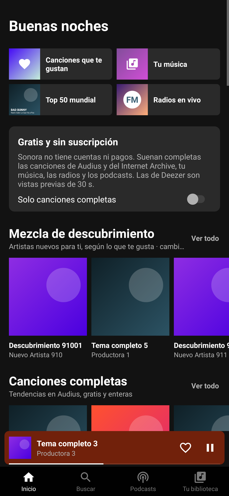
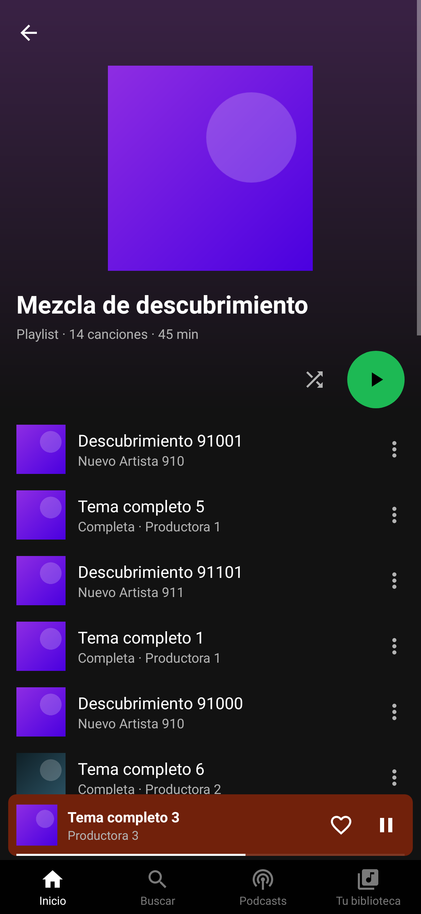
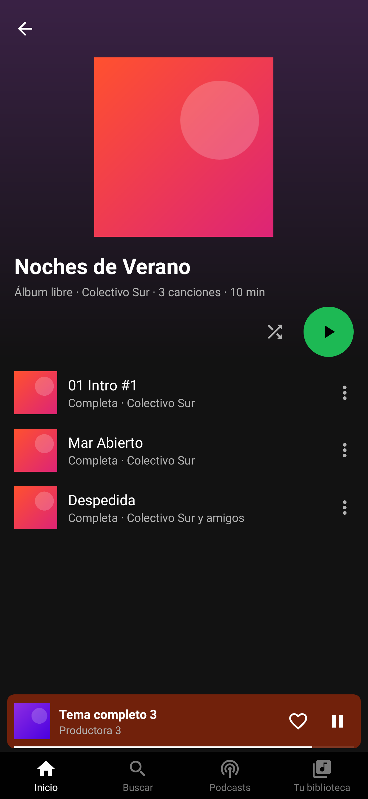
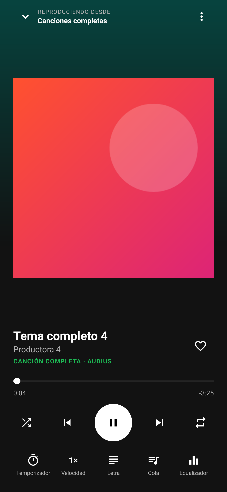
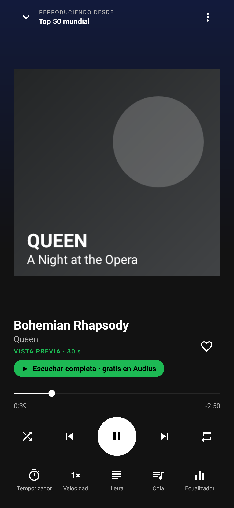
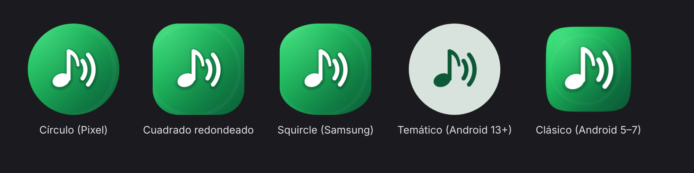

# Sonora — reproductor de música estilo Spotify (Android)

APK listo para instalar: [`dist/Sonora.apk`](dist/Sonora.apk) (v1.9, **Android 8.0+**, ~2,3 MB).

| Inicio | Mezcla de descubrimiento | Álbum libre | Canción completa | Vista previa → completa |
|---|---|---|---|---|
|  |  |  |  |  |

*(Capturas generadas en el simulador con datos de ejemplo; en el teléfono se ven las portadas y listas reales.)*

Hoja de ruta: [`ROADMAP.md`](ROADMAP.md).

**Versión para computadora (Windows / macOS / Linux): [`../sonora-pc`](../sonora-pc/README.md).**

## Novedades de la 1.9 — Música completa, Media3, Mezcla de descubrimiento y sin suscripción
- **Música completa, gratis y sin cuenta**:
  - **Audius**: plataforma donde los artistas suben sus canciones enteras. Estante "Canciones completas" (tendencias) y estantes por género (electrónica, hip hop, lo-fi, latina, pop, rock, ambient). También aparece en la búsqueda.
  - **Internet Archive**: "Álbumes libres" (discos de netlabels con licencia libre) y "Conciertos en vivo"; cada álbum se abre como cualquier otro y suena entero.
  - Las canciones completas llevan la etiqueta **"Completa"** en las listas y **"CANCIÓN COMPLETA · AUDIUS / INTERNET ARCHIVE"** en el reproductor. Se omiten las canciones de Audius que el artista reserva a seguidores o vende.
- **Sin suscripción**: Sonora no tiene cuentas ni pagos. Una tarjeta en Inicio lo explica, con el interruptor **"Solo canciones completas"**, que oculta en toda la app las vistas previas de 30 s de Deezer (estantes, búsqueda y mezcla) y deja solo lo que suena entero: Audius, Internet Archive, tu música, radios y podcasts.
- **"Escuchar completa"**: mientras suena una vista previa, Sonora busca la misma canción en Audius y, si existe (mismo título y mismo artista, sin contar "(feat. …)" ni "- Remastered"), ofrece cambiar a la versión entera en el mismo lugar de la cola. Nunca ofrece versiones o canciones de otro artista.
- **Mezcla de descubrimiento**: hasta 30 canciones de **artistas que todavía no escuchas**, parecidos a los que te gustan. Usa tus ♥ (pesan 3) y tu historial (pesa 1); suma artistas relacionados del catálogo y canciones completas de Audius de los géneros que escuchas ahí. Nunca repite lo que ya te gusta o escuchaste, como mucho 2 por artista, y **cambia cada día**. Sin historial es una mezcla de inicio con lo que suena hoy.
- **Media3 (ExoPlayer)** como motor de audio, en lugar de MediaPlayer:
  - **Sin pausas entre canciones**: la siguiente se precarga 12 s antes del final y empieza sin hueco.
  - **Radios HLS** (.m3u8) y redirecciones http↔https.
  - En las radios que lo envían, **"Ahora suena: …"** (título de la canción al aire) en el reproductor y la notificación.
  - Media3 gestiona el foco de audio: pausa con llamadas y baja el volumen con avisos del GPS. También pausa al desconectar auriculares o Bluetooth.
  - Ecualizador, velocidad, temporizador, cola, sesión y todo lo anterior siguen igual.
  - Corregido: adelantar o retroceder mientras una canción todavía carga ya no se ignora.

### Por qué ahora pide Android 8.0
Media3 y Guava usan funciones de Java 8 que, sin el compilador de Google (D8), solo funcionan desde Android 8.0. El entorno de construcción no permite usar D8, así que la 1.9 deja de instalarse en Android 5, 6 y 7. Si eso importa, la solución es compilar con D8; está anotado en la hoja de ruta.

### Lo que no se pudo comprobar
- Las APIs reales de **Audius** y del **Internet Archive** no eran accesibles desde el entorno de construcción. Se programaron según su formato documentado y se probaron con respuestas de ejemplo con esa forma; si Audius cambió algo (por ejemplo, si ahora exige clave), se notará en la primera prueba real.
- Media3 se probó de verdad (no simulado) reproduciendo archivos WAV en el simulador de Android: carga, duración, avance, paso sin pausa a la siguiente, error y salto, y adelantar mientras carga. No se probó en un teléfono ni con streaming real.
- Fundido entre canciones (crossfade) no está: Media3 no lo trae y requiere dos reproductores; queda para después.

## Novedades de la 1.7
- **Icono nuevo**: una corchea con dos ondas de sonido sobre verde. Es **adaptable** (se ve bien en círculo, cuadrado o squircle según el teléfono), tiene capa **monocroma** para los iconos temáticos de Android 13+ y PNG clásicos para Android 5–7.
- El icono lo **dibuja un programa en Rust** ([`crates/sonora-icon`](../crates/sonora-icon)) sin dependencias: formas por campos de distancia con bordes suavizados y su propio codificador PNG/ICO. Para regenerarlo: `cargo run -p sonora-icon --release -- .` desde la raíz del repositorio.



## Novedades de la 1.6.1
- **Fandoms y gaming**: estante de artistas de música de internet y de inspiración en videojuegos (The Living Tombstone, CG5, Black Gryph0n, Baasik, NateWantsToBattle, DAGames, TryHardNinja, Rockit Gaming, Miracle Of Sound, Random Encounters, Dan Bull, Griffinilla, Jonathan Young, Jack Stauber) y un estante propio de **The Living Tombstone**. Cada artista se busca por nombre exacto en el catálogo de Deezer; los que no estén se omiten. Se oyen como el resto del catálogo: **vistas previas de 30 s** (la app no incluye archivos de audio). Cualquier otro artista se encuentra con Buscar.

## Novedades de la 1.6 (contenido)
- **Podcasts** (nueva pestaña): populares de tu país (Apple Podcasts), búsqueda, temas, **seguir** programas y **episodios completos** leídos del feed RSS de cada podcast. Se retoma cada episodio donde lo dejaste ("faltan 27 min"), hay una fila "Seguir escuchando" y botones **−15 s / +30 s** en el reproductor. Los enlaces con redirecciones se resuelven antes de reproducir.
- **Álbumes, artistas, playlists y géneros** de Deezer con su propia página: "Nuevos lanzamientos", "Artistas populares", "Playlists populares" y "Géneros" (el top de cada estilo).
- **Muchas más radios**: noticias, deportes, rock, pop, latina, clásica, jazz y electrónica.
- **Más estantes de música**: hip hop, electrónica, jazz, clásica, indie, salsa, bachata, baladas, entrenar, relajarse, fiesta, lo-fi, cumbia y trap.
- Inicio muestra los estantes principales; el resto carga al abrirlo (Buscar → explorar todo). Tus podcasts seguidos están también en Tu biblioteca.

## Novedades de la 1.5
- **Letras sincronizadas** (LRCLIB): la línea que suena se ilumina y la pantalla la sigue; toca una línea para saltar a ella. Si solo hay letra sin tiempos, se muestra completa.
- **Ecualizador**: 10 ajustes (Rock, Pop, Jazz, Clásica, Electrónica, Hip hop, Voz…), una barra por banda de tu dispositivo, refuerzo de graves y sonido envolvente.
- **Temporizador de apagado**: 5 min a 1 hora o "al terminar esta canción"; baja el volumen suavemente antes de parar.
- **Velocidad de reproducción**: 0.5× a 2×.
- **Cola interactiva**: toca para saltar, ✕ para quitar, "Limpiar" para vaciar lo que sigue.
- **Retoma donde lo dejaste**: al abrir la app vuelve la última cola, en pausa y en el mismo segundo.
- **Escuchado recientemente** en Inicio y en la biblioteca, **búsquedas recientes**, **cambiar nombre** de playlists y **compartir** canción.

## Música real
- **Catálogo de Deezer** (API pública, sin cuenta): Top 50 mundial, Reggaetón, Pop latino, Rock en español,
  Cumbia y Trap, más búsqueda de cualquier canción o artista y la página de cada artista con sus éxitos.
  Deezer solo permite **vistas previas de 30 segundos** sin suscripción; los enlaces caducan, así que la app
  pide uno nuevo justo antes de reproducir.
- **Radios en vivo** (radio-browser.info): las emisoras más escuchadas de tu país (según el idioma/país del
  teléfono), con **canciones completas**. También aparecen en la búsqueda.
- Las canciones y radios que marques con ♥ o guardes en playlists se recuerdan aunque reinicies sin internet.

## Qué hace
- **Tu música**: lee las canciones guardadas en el teléfono (MP3, M4A, FLAC…) con portada embebida; se escuchan completas.
- Reproducción en segundo plano con notificación multimedia, pantalla de bloqueo, botones de auriculares/Bluetooth.
- Mini‑reproductor, pantalla completa con barra de progreso, aleatorio, repetir (todo / una), anterior/siguiente.
- ♥ "Canciones que te gustan", playlists propias (crear, añadir, quitar, eliminar), artistas y álbumes.
- Búsqueda instantánea (ignora acentos), "Reproducir a continuación", cola de reproducción.
- Se pausa al desconectar auriculares y respeta llamadas/otras apps (audio focus, a cargo de Media3).

## Compilar
Sin Gradle ni Android Studio: Java + herramientas del SDK de Debian/Ubuntu.
```bash
sudo apt install aapt dalvik-exchange zipalign apksigner openjdk-21-jdk-headless git
./build.sh            # -> build/Sonora.apk
```
La primera vez, `build.sh` llama a `tools/build-media3.sh`, que **compila Media3 1.4.1 desde su código fuente** (GitHub) junto con Guava (Maven Central) en `libs/media3-bundle.jar`. Se hace así porque los paquetes oficiales de Media3 solo están en el repositorio de Google. Las pocas clases de `androidx` que Media3 necesita están reemplazadas por versiones mínimas en `third_party/media3-shims`. La licencia de Media3 (Apache 2.0) va dentro del APK (`assets/licenses`).

`sonora-release.jks` es la clave de firma (contraseña `sonora123`); conservarla permite instalar futuras versiones encima.

## Pruebas
```bash
./build.sh && ./test/run-tests.sh          # todas (59)
./test/run-tests.sh FullMusicTest          # una clase
```
Corren en la JVM con Robolectric, sin emulador. El script prepara todo la primera vez (Robolectric y la imagen de Android desde Maven Central; `androidx.test` compilado desde su código). Antes las pruebas solo existían en la sesión de trabajo; ahora se pueden repetir desde el repositorio.

- `SmokeTest`, `BigUpdateTest`, `ContentTest`: lo de la 1.0 a la 1.6 (secciones, reproducción con enlace renovado, radios, búsqueda, playlists, persistencia, sin conexión, temporizador, cola, sesión, letras, ecualizador, podcasts, álbumes).
- `FullMusicTest`: lo de la 1.9 (Audius, Internet Archive, "Solo canciones completas", "Escuchar completa", paso sin pausa, repetir una y "al terminar", mezcla de descubrimiento, radio "ahora suena").
- `Media3Test`: el **ExoPlayer real** reproduciendo archivos WAV.
- Las demás usan `SimAudio`, un reproductor simulado con tiempos deterministas, y `Fixtures.java`, con respuestas con la forma de las APIs reales.
