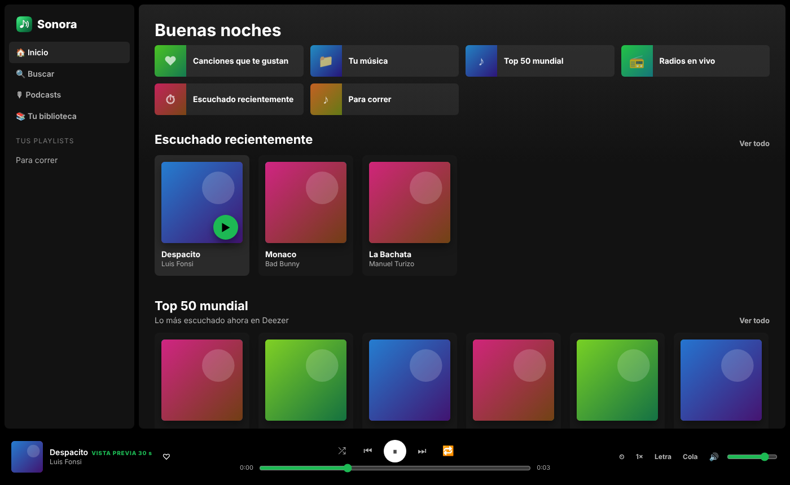
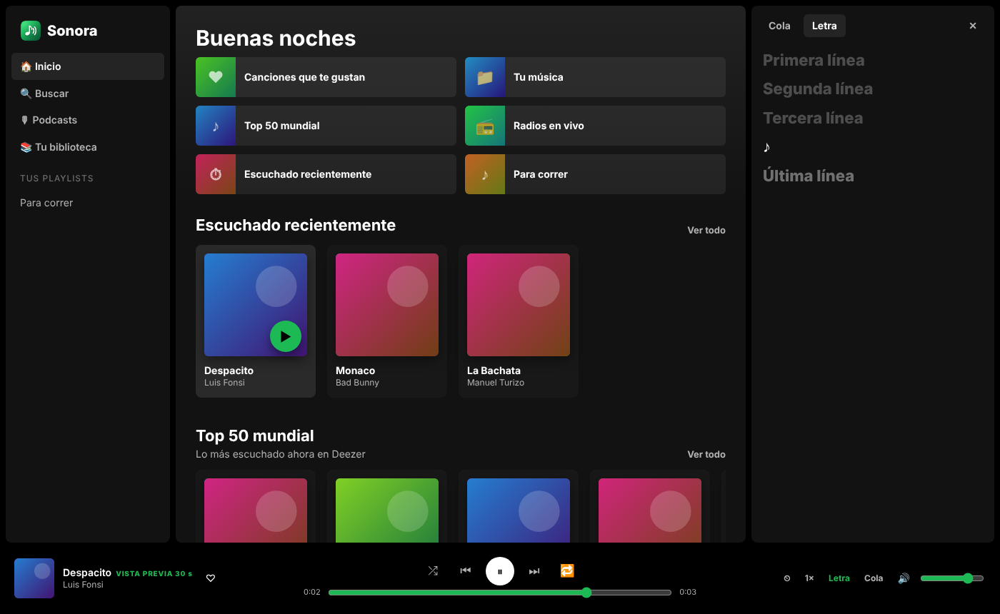
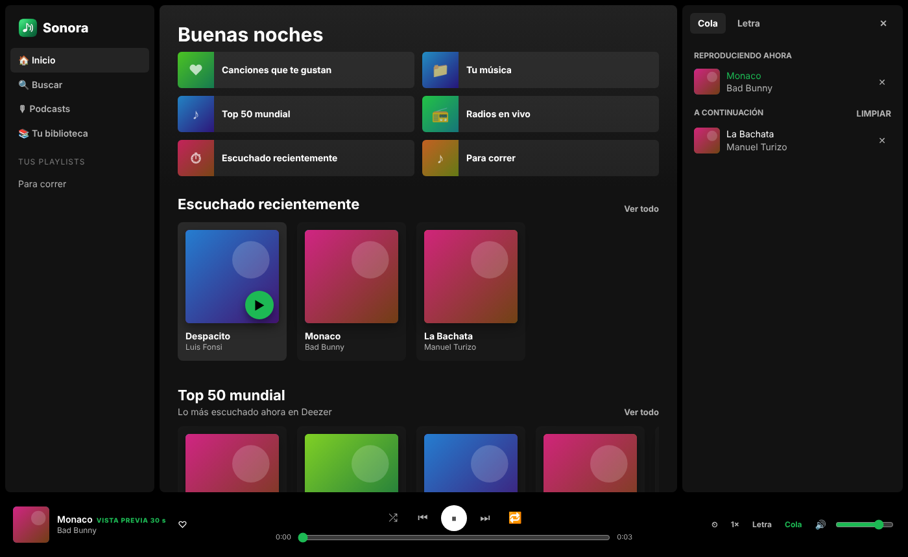
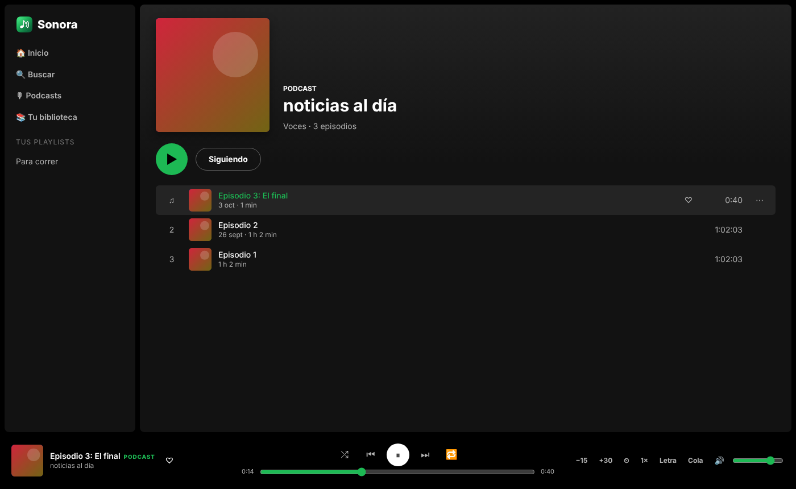

# Sonora para PC · v1.7

La versión de escritorio de Sonora: el mismo reproductor, con estantes de música, radios en vivo, podcasts, letras, cola y playlists, más **tu carpeta de música del PC**. Funciona en **Windows, macOS y Linux** con solo [Node.js 18+](https://nodejs.org) (sin instalar paquetes).

| Inicio | Letra sincronizada | Cola | Podcast |
|---|---|---|---|
|  |  |  |  |

*(Capturas con datos de ejemplo.)*

Novedad de la 1.7: icono nuevo (favicon `.ico` con 6 tamaños y PNG), generado en Rust por [`crates/sonora-icon`](../crates/sonora-icon).

## Cómo se usa

```bash
cd sonora-pc
node server.js --open        # o: ./start.sh   ·   en Windows: doble clic en start-windows.bat
```

Se abre `http://localhost:5174` en tu navegador. Opciones:

| Opción | Para qué |
|---|---|
| `--music CARPETA` | carpeta de música (por defecto, `Música` de tu usuario) |
| `--port N` | otro puerto (por defecto 5174) |
| `--open` | abre el navegador solo |

## Qué incluye

- **Tu música**: lee MP3, M4A, AAC, OGG, Opus, FLAC y WAV de tu carpeta (subcarpetas incluidas), con título, artista, álbum y **portada** de las etiquetas ID3 de los MP3. Se oye completa.
- **Catálogo de Deezer**: Top 50, géneros, nuevos lanzamientos, artistas, álbumes, playlists, "Fandoms y gaming" y The Living Tombstone. Son **vistas previas de 30 s** (no hay audio completo sin suscripción).
- **Radios en vivo** (radio-browser.info), **podcasts** con episodios completos (Apple Podcasts + feeds RSS): seguir, retomar cada episodio donde lo dejaste, −15 s / +30 s.
- **Letras sincronizadas** (LRCLIB), **cola** editable, **temporizador de apagado** (con fundido), **velocidad** 0.5×–2×, **me gusta**, **playlists**, historial y búsquedas recientes.
- La **sesión se recuerda**: al volver a abrir, la última cola queda en pausa en el mismo segundo.
- Controles multimedia del sistema (teclas del teclado, auriculares, pantalla de bloqueo) mediante la API Media Session.

### Atajos

`Espacio` pausa/reproduce · `←` `→` ∓5 s · `Shift+←` `Shift+→` anterior/siguiente · `↑` `↓` volumen · `M` silencio · `S` aleatorio · `R` repetir · `F` me gusta · `L` letra · `Q` cola · `/` buscar

## Cómo funciona y privacidad

El servidor (`server.js`) escucha **solo en 127.0.0.1**, sirve la interfaz y hace de proxy hacia Deezer, Apple Podcasts, radio-browser, LRCLIB y los feeds RSS (así el navegador no choca con CORS). Tus playlists, "me gusta" e historial se guardan **solo en tu navegador** (localStorage). Nada se envía a servidores propios: no existen.

Seguridad del servidor local: rechaza peticiones con otro `Host` (protección contra DNS rebinding) y con otro `Origin`; el proxy de feeds **bloquea direcciones privadas** (`localhost`, redes locales, metadatos de la nube) y protocolos que no sean http/https, limita el tamaño y el tiempo; solo sirve archivos de `public/` y los de tu carpeta de música indexados por número (nunca por ruta).

## Límites (con honestidad)

- Se probó con **Chromium en Linux** (pruebas automáticas, abajo). No se ha probado en Windows ni macOS, ni en Firefox/Safari/Edge; no debería haber diferencias, pero es lo primero que hay que confirmar.
- Las respuestas de Deezer, Apple, radios y LRCLIB se **simularon** en las pruebas: aquí no hay acceso a esas APIs. Si alguna cambia su formato, se notará en la primera ejecución real.
- Las vistas previas de Deezer duran 30 s; para canciones completas usa tus archivos o las radios.
- No hay empaquetado en `.exe`/`.app`: se ejecuta con Node.js.
- Ecualizador, refuerzo de graves y descargas sin conexión (de la versión Android) no están en la de PC.

## Pruebas

```bash
npm install        # solo playwright-core, para las pruebas
npm test           # 14 pruebas de extremo a extremo
```

Arrancan el servidor real y un Chromium real contra un servidor que imita las APIs y sirve **audio WAV real**, de modo que se comprueba el sonido (que `currentTime` avance), no solo la pantalla: reproducción, enlaces caducados, avance automático, redirecciones de podcasts, retomar episodios, sesión tras recargar, cola, letras, búsqueda, playlists, temporizador, carpeta de música con etiquetas ID3, sin conexión, y seguridad del servidor (Host, Origin, rutas, SSRF, Range). Para regenerar las capturas: `node test/shots.js`.
