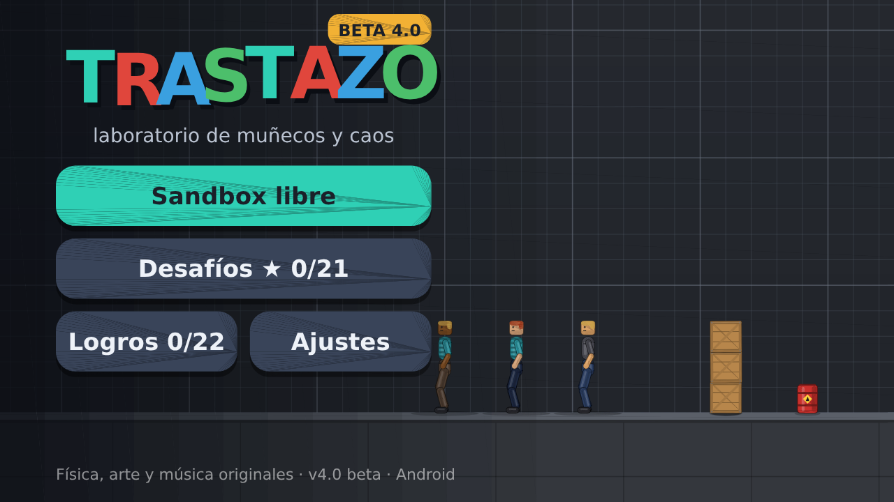
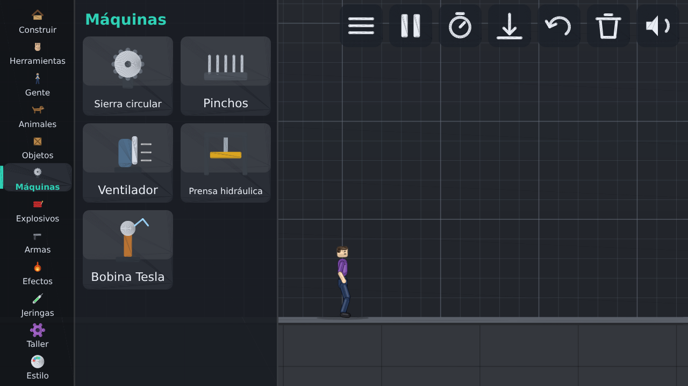

# Trastazo para Unity

El juego completo (4.0 beta) llevado a **Unity**: el mismo motor de física, personajes, IA, destrucción,
máquinas, refrigerador, animales, retos, logros, mods, música y efectos de sonido. Funciona en
**Android, Windows, Linux y macOS** (cualquier plataforma de escritorio o móvil que soporte Unity).

> **Estado, con honestidad:** el código del juego se ha traducido de Java a C# y **se ha probado entero fuera
> de Unity** (ver [Verificación](#verificación)). La capa que habla con Unity (dibujo, audio, entrada, editor de
> mods) está escrita con la API documentada de Unity y comprobada de tipos contra el código real, pero **no se
> ha podido abrir en un Editor de Unity** en el entorno donde se hizo. Es la primera vez que se compila dentro
> de Unity: si algo falla al abrir, el informe de errores o la consola de Unity dirán dónde.




*(Capturas del juego dibujado por el mismo código de dibujo que usa Unity, volcado a SVG en las pruebas.)*

## Abrirlo

1. **Unity Hub → Add → Add project from disk** y elegir esta carpeta (`trastazo-unity`). Unity **2022.3 LTS o
   superior** (también Unity 6). Si pide actualizar el proyecto, aceptar.
2. Al abrir por primera vez se configuran solos los ajustes del jugador (nombre, orientación horizontal,
   IL2CPP/ARM64 en Android, espacio de color Gamma). También están en el menú **Trastazo → Configurar proyecto**.
3. Pulsar **Play**. No hace falta crear ninguna escena: el juego se arranca solo (`TrastazoBootstrap`) en
   cualquier escena, también en una vacía. (**Trastazo → Crear escena** crea `Assets/Scenes/Trastazo.unity`
   para las compilaciones.)

### Compilar

Menú **Trastazo → Compilar →** Android (APK) / Windows / Linux / macOS. Salen en `Builds/`. Para Android hace
falta el módulo *Android Build Support* (con SDK/NDK/OpenJDK) instalado desde Unity Hub. Desde la línea de
comandos: `Unity -batchmode -quit -projectPath . -executeMethod TrastazoUnityEditor.TrastazoEditor.BuildAndroid`.

## Controles

* **Móvil:** como la versión Android: toca y arrastra (varios dedos), botón *Atrás* = menú/pausa.
* **PC:** ratón (clic izquierdo = tocar/arrastrar, derecho o central = mover cámara, rueda = zoom o desplazar el
  catálogo), `Esc` menú, `Espacio`/`P` pausa, `S` cámara lenta, `G` gravedad, `H` mano, `1`–`9`,`0` categorías,
  `+`/`-` zoom, flechas o `WASD` mover cámara, `Ctrl+Z` deshacer, `F11` o `Alt+Enter` pantalla completa.

Los datos (autoguardado, ajustes, mods `.rpmod`, informe de errores `trastazo-informe.txt`, caché de música) están
en `Application.persistentDataPath`. El **editor de mods** del Taller es un cuadro de texto sobre el juego (IMGUI).

## Cómo está hecho

```
Assets/Trastazo/
  Core/                  C# puro (asmdef sin referencias a Unity, compila también con `dotnet`)
    Generated/           el juego, traducido de Java por tools/java2cs.py  ← no editar a mano
    Compat/JavaCompat.cs   runtime tipo Java: Math, JList, StringBuilder, Random (mismo generador), Fmt.format, File...
    Gfx/                   Canvas / Paint / Path / RectF: reciben las órdenes de dibujo y las convierten en triángulos
    Sfx.cs, MusicPlayer.cs síntesis de efectos y mezclador de la banda sonora (independientes de Unity)
    Driver.cs, Report.cs   ratón/teclado/escala, ajustes en texto, informe de errores
  Unity/                 la capa de Unity (≈ 800 líneas)
    TrastazoApp.cs         MonoBehaviour: bucle, tamaño de pantalla, ciclo de vida, guardado, vibración
    UnityCanvasRenderer.cs el fotograma (triángulos + texto) → un Mesh dibujado con una cámara ortográfica
    UnityInput.cs          toques, ratón y teclado (Input System o Input Manager clásico, el que use el proyecto)
    UnityAudio.cs          efectos con un banco de AudioSources; música en streaming (AudioClip con callback)
    ModEditor.cs           editor de mods (IMGUI)
  Resources/             dos shaders sin iluminación (TrastazoSolid, TrastazoText)
  Editor/                ajustes del proyecto y menú Trastazo
```

* **Un solo código de juego.** Java sigue siendo la fuente (`../trastazo/src`): `tools/java2cs.py` lo traduce
  a C# (tipos, `instanceof`, `foreach`, `>>>`, literales hexadecimales de 32 bits, constantes, modificadores de
  acceso, `override`...) y `Compat/JavaCompat.cs` aporta lo que Java traía de serie (el mismo generador
  aleatorio, `String.format`, listas...). Para regenerar tras tocar el Java: `tools/build_core.sh`.
* **Dibujo.** El juego pinta en un `Canvas` (el mismo código de interfaz y mundo que en Android/PC). Aquí ese
  `Canvas` no dibuja píxeles: **tesela** rectángulos, círculos, arcos, trazos y rutas en triángulos (con
  recorte y transformaciones) y deja una lista en orden de pintado (`DrawList`). `UnityCanvasRenderer` la sube
  a **un único Mesh** por fotograma, con un submesh por tramo (triángulos / texto) y una profundidad creciente
  para conservar el orden. El texto usa la fuente del sistema (`Font` dinámica) sobre quads de glifos.
  El suavizado de bordes lo hace el MSAA (se pide ×4 al arrancar; en URP actívalo en el *URP Asset*).
* **Sonido.** Los efectos se sintetizan al arrancar (las mismas fórmulas) y se reproducen con volumen y
  velocidad variables; la música se compone en segundo plano, se guarda en caché y se mezcla en un
  `AudioClip` de streaming con fundidos y la capa de «acción».

## Verificación

Todo lo siguiente se ejecuta fuera de Unity, con .NET (`tools/test_all.sh`; 8.0, C# 9 como Unity):

| Qué | Resultado |
|---|---|
| El juego traducido (28 archivos, ~12 000 líneas) compila | sí, 0 errores |
| `PhysTest` física: pilas, rodar, péndulo, músculo, soldaduras, coche | todo pasa |
| `PersonTest` ragdoll activo: se levanta, camina, corre, gira | todo pasa |
| `WorldTest`, `AiTest`, `BuildTest`, `DestroyTest`, `AnimalTest`, `Test39`, `InputTest` | todo pasa |
| `MachineTest` (sierra, pinchos, prensa, Tesla...) | pasa; 3 comprobaciones de pinchos son *intermitentes* (también en Java, dependen del azar) |
| `Test40` (informe de errores, guardado seguro, botones en 7 tamaños) | todo pasa |
| `MonkeyTest` (acciones al azar) y `SoakTest` (30 semillas × 40 s con todos los objetos) | sin excepciones ni NaN |
| Dibujo | `LayoutShot` y `CanvasDemo` generan SVG con el teselador; revisados a ojo (capturas de arriba) |
| Capa de Unity | se comprueba de tipos con `dotnet build tests/UnityLayer.csproj` (y `UnityLayerNew.csproj` para la rama del Input System) contra *stubs* de la API de Unity y el código real |

Lo que **no** está verificado y es lo primero que hay que mirar en Unity: que los shaders compilen en tu
pipeline (probados solo «sobre el papel»; hay *fallback* a `Sprites/Default`), la orientación de los glifos
(`UnityCanvasRenderer.DetectGlyphOrientation` la detecta sola), que el orden de pintado por profundidad se
respete en tu versión/pipeline, el rendimiento en móviles de gama baja y el audio en streaming.

## Diferencias con Android / PC

* No existe el motor «GPU (OpenGL ES)»: Unity ya agrupa el dibujo. Se usa siempre la ruta *Canvas* (la misma
  que el motor de reserva de Android), así que **no hay luces ni destellos por GPU**.
* Un `float` fuera de rango o `NaN` convertido a `int` no da el mismo valor en C# que en Java; el bucle del
  juego sigue protegido por el mismo `try/catch` que registra el error y sigue jugando.
* La vibración usa JNI en Android (`Vibrator`); en el resto, nada.

## Pruebas y herramientas

```
tools/java2cs.py         traductor Java → C#            (python3 tools/java2cs.py ../trastazo/src/com/frameboost/ragdoll Assets/Trastazo/Core/Generated)
tools/build_core.sh      traduce y compila el núcleo con dotnet
tools/test_all.sh        traduce juego y pruebas, compila las pruebas
tools/run_tests.sh            corre toda la batería; o una a una: dotnet /tmp/trz-cs-tests/Tests.dll PhysTest (también PersonTest WorldTest AiTest BuildTest DestroyTest
                                                    AnimalTest MachineTest Test39 Test40 InputTest MonkeyTest
                                                    SoakTest LayoutShot CanvasDemo; las que guardan imágenes
                                                    reciben una carpeta como argumento y escriben SVG)
```
