# Trastazo Playground para Unity — 2.9

El juego completo (4.0 beta) llevado a **Unity**: el mismo motor de física, personajes, IA, destrucción,
máquinas, refrigerador, animales, retos, logros, mods, música y efectos de sonido. Funciona en
**Android, Windows, Linux y macOS** (cualquier plataforma de escritorio o móvil que soporte Unity).

> **Estado, con honestidad:** el código del juego se ha traducido de Java a C# y **se ha probado entero fuera
> de Unity** (ver [Verificación](#verificación)). La capa que habla con Unity (dibujo, audio, entrada, editor de
> mods) está escrita con la API documentada de Unity y comprobada de tipos contra el código real, pero **no se
> ha podido abrir en un Editor de Unity** en el entorno donde se hizo. Es la primera vez que se compila dentro
> de Unity: si algo falla al abrir, el informe de errores o la consola de Unity dirán dónde.

## Novedades de Trastazo Playground Unity 2.9

* **Mejor destrucción:** el fuego consume la madera y derriba casas, trozos con esquinas astilladas, muros con mordiscos
  de daño, estela de polvo en los cascotes y más escombros. Test27 traducido a C#.

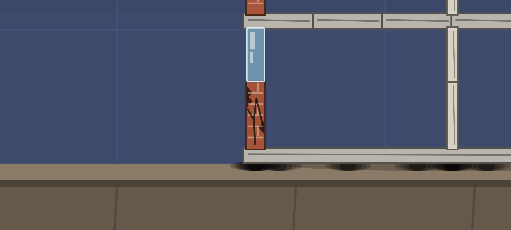

## Novedades de Trastazo Playground Unity 2.8

* **Nueva destrucción:** grúa de demolición con bola de acero, agujeros de bala, hormigón con armadura, acero que se desgarra,
  esquirlas y polvo. Test26 traducido a C#.

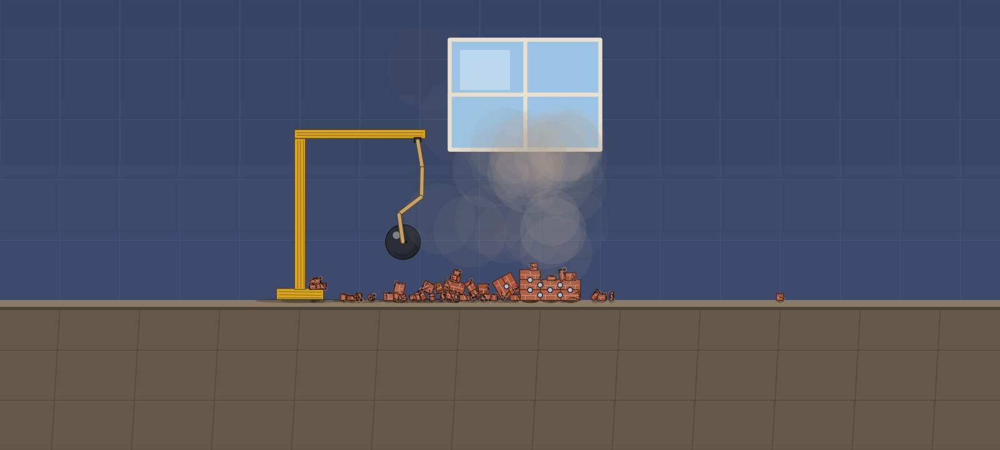

## Novedades de Trastazo Playground Unity 2.7

* **Levolution V5:** inundación (flotación, ahogamiento), meteoritos con cráteres e incendios, tormenta con lluvia y rayos,
  tornados EF1-EF5, terremoto con epicentro y explosiones secundarias tras el derrumbe. Test25 traducido a C#.

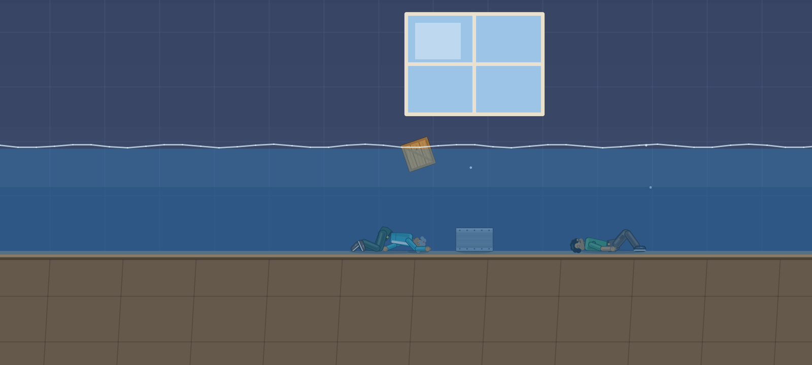

## Novedades de Trastazo Playground Unity 2.6

* **Levolution V2:** derrumbe en tortita con polvo y neblina, terremoto con onda lateral, grietas y réplica, bombardeo con
  cráteres y columnas de humo, tornado en forma de cuerda con nube. Test24 actualizado.

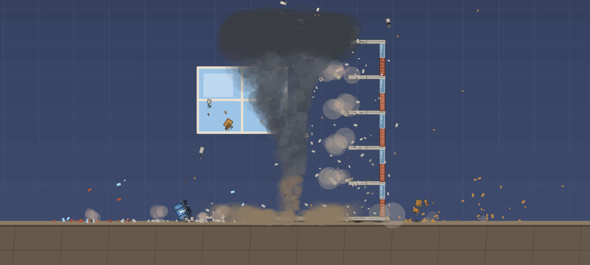

## Novedades de Trastazo Playground Unity 2.5

* **Levolution:** derrumbe controlado con ola de polvo, terremoto, bombardeo y tornado (pestaña nueva). Test24 traducido a C#.

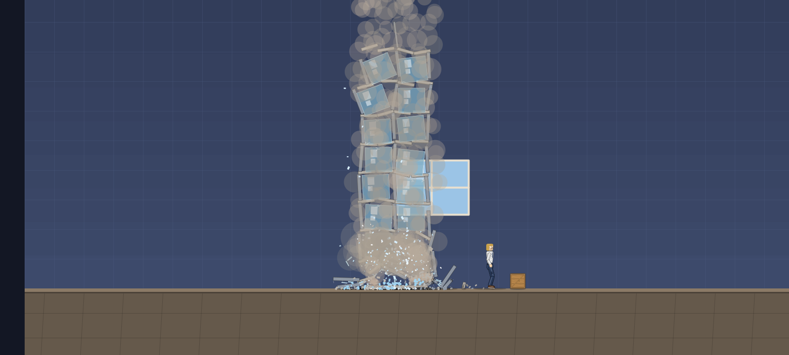

## Novedades de Trastazo Playground Unity 2.4

* **Edificio y Rascacielos** completos y **destrucción tipo The Finals**: agujeros por explosión, integridad estructural
  (lo que pierde apoyo cae, un forjado no puede volar más de dos secciones), nubes de polvo y edificios que no gastan
  física hasta que se dañan. Test23 traducido a C#.

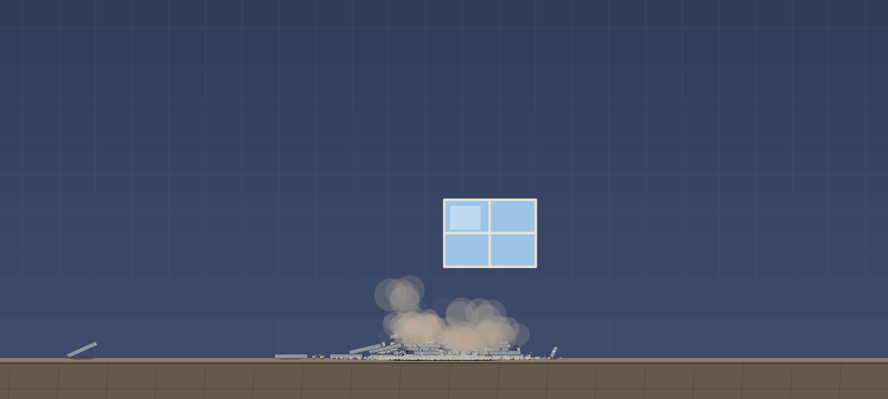

## Novedades de Trastazo Playground Unity 2.3

* **Más trampas** (ahora 8 en *Trampas SAW*): **mina** (clic y explosión al pisarla), **guillotina** (cae sobre quien pasa
  debajo y se iza sola), **lanzallamas** (ráfagas de fuego) y **láser** (rayo a ras de suelo que corta piernas).
  Test22 traducido a C#.

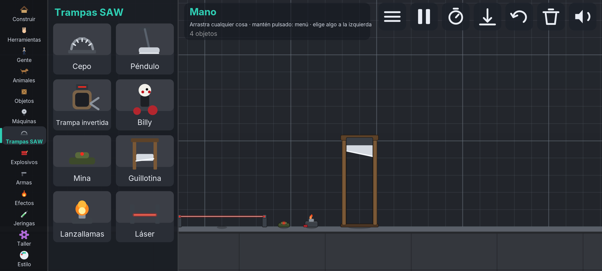

## Novedades de Trastazo Playground Unity 2.2

* **Sangre V6 (remake, más realista):**
  * **Sangre arterial vs. venosa:** los chorros del cuello y de los muñones son de un rojo vivo y más rápidos;
    la que rezuma de heridas normales es oscura y espesa.
  * **Gotas y salpicaduras:** las gotas brillan al volar y, si caen rápido, **se rompen en gotitas satélite**
    que rebotan hacia arriba al chocar con el suelo.
  * **Cuerpos que gotean:** lo que empapa la ropa y la piel **gotea** desde las partes más bajas, gota a gota,
    hacia los charcos (y el cuerpo se va «secando»).
  * **Charcos con estructura:** borde que se seca primero (línea oscura), centro que **se coagula** en gelatina
    oscura y, pasado más de un minuto, **grietas** de sangre seca.
  * **Pared:** las manchas ya no son redondas: **estrías finas** salen disparadas con gotitas en las puntas,
    además de los satélites y los chorretones.
  * **Armas ensangrentadas:** cuchillos y espadas (y la sierra y las trampas) que cortan carne quedan
    **mojados de sangre** desde la punta hacia atrás.

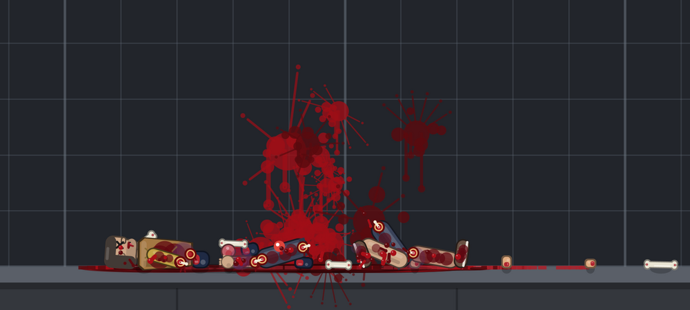
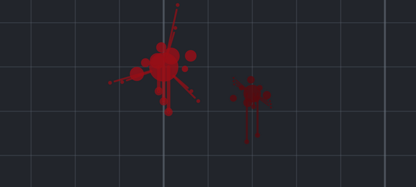
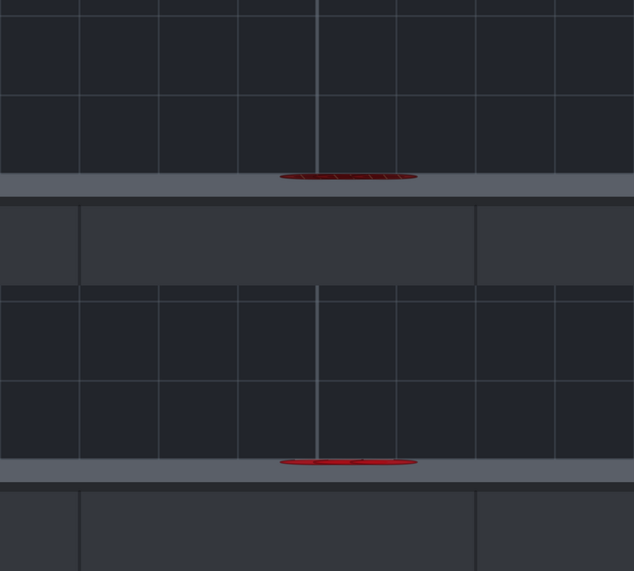

## Novedades de Trastazo Playground Unity 2.1

* **Gore V6 (más realista):**
  * **Sangre real:** rojo más oscuro y menos saturado (arterial vs. venosa), y una **fina niebla de gotitas**
    cuando el golpe es fuerte.
  * **Palidez:** quien pierde sangre se queda **pálido** (hasta un 50 %); los muertos se ponen **gris
    azulados** con los minutos.
  * **Heridas que se coagulan:** una herida fresca es roja, húmeda y brillante; en ~45 s se **seca y se
    oscurece**, y deja de gotear. Los cortes muestran la **piel doblada** en los bordes y los agujeros de bala
    un **anillo oscuro** de abrasión. Los **moratones** cambian de color con el tiempo: morado → azul → verde
    amarillento.
  * **Espasmos de agonía:** al morir, el cuerpo se **convulsiona** ~1,5 s y se queda quieto.
  * **Muñones a presión:** un miembro arrancado a alguien vivo **escupe chorros al ritmo del corazón**.
  * **Sangre en la boca:** un pecho destrozado hace **toser sangre**, que mancha la cara y gotea por la barbilla.
  * **Trozos más creíbles:** fibras musculares y borde de grasa en la carne, y **médula** roja en los extremos de
    los huesos.
  * Con el gore apagado, nada de esto aparece (salvo la palidez).
* **Hombre óxido:** ya no ataca a los infectados (se unirán a él) y la infección por zarpazo sube al 70 %.

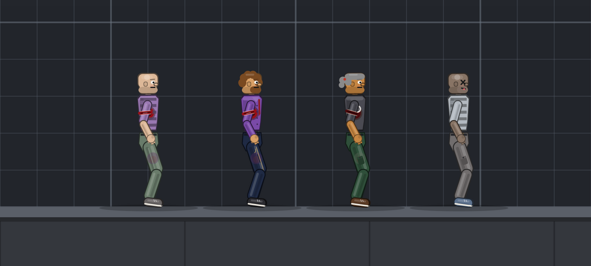
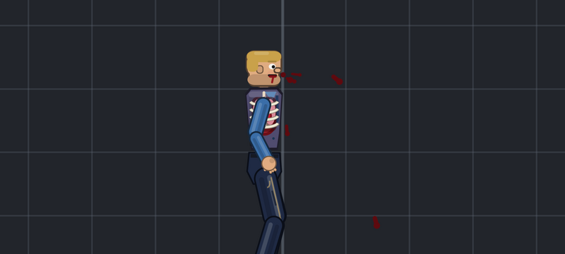

## Novedades de Trastazo Playground Unity 2.0

* **Hombre óxido y Barra de óxido:**
  * **Barra de óxido** (categoría *Máquinas*): una barra corroída. **Quien la toque se infecta**: el óxido se
    extiende por su cuerpo en manchas naranjas durante 7 s y, **al completarse, se convierte en Hombre óxido**
    (reaparece con la vida llena). *Activar* la apaga. Los esqueletos y los muertos son inmunes.
  * **Hombre óxido** (categoría *Gente*, también se puede colocar directamente): piel de metal corroído, cresta
    de pinchos, púas en los hombros, placa remachada con grietas incandescentes, ojos encendidos y **garras de
    acero**. Caza a todo el que esté vivo (zombis incluidos): cada zarpazo hace cortes profundos y a veces
    arranca un miembro; **mata o infecta de óxido** (70 %), y los infectados se convierten en nuevos Hombres
    óxido. Sangra naranja y aguanta casi el doble. Se guarda y se carga con la infección en curso.
* **Modelo de humanos renovado (V3):** torso con hombros y cintura, caderas, cuello, **cabeza con mandíbula**
  (cráneo ancho sobre mandíbula más estrecha), **manos con dedos y pulgar**, hombros con luz y sombra. Las
  heridas y la sangre se siguen viendo encima.

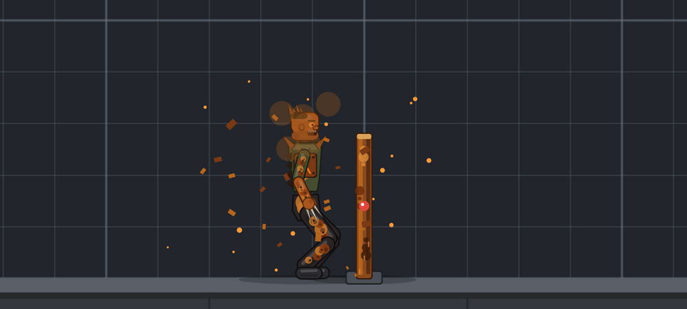
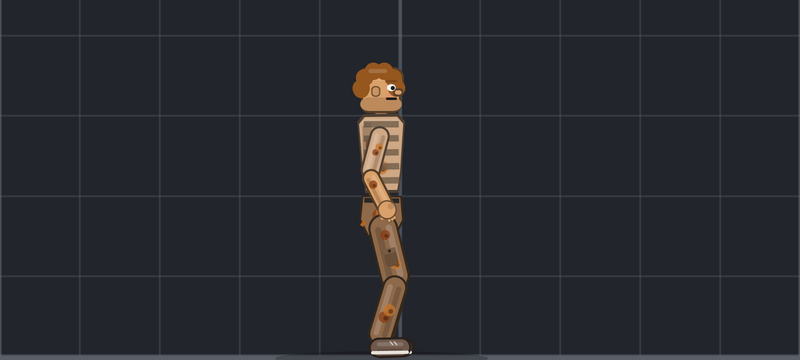
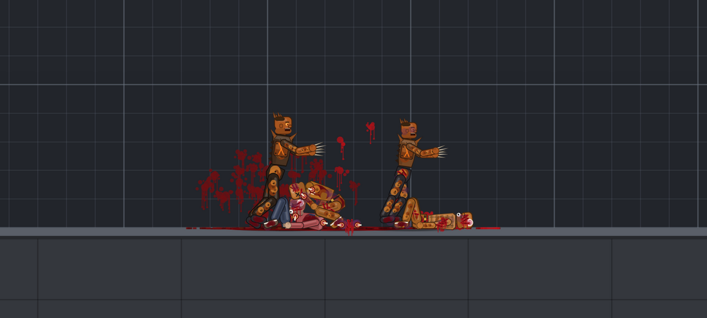
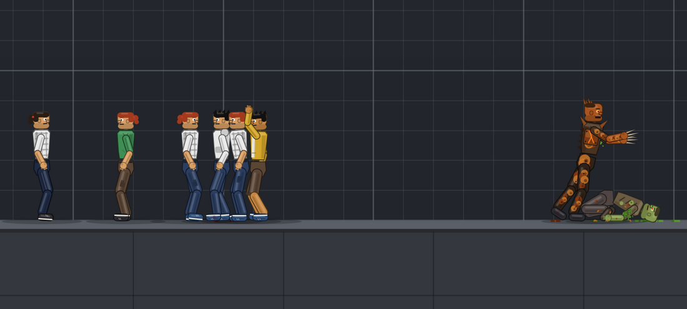

## Novedades de Trastazo Playground Unity 1.9

* **Sangre V3 + Gore V5:**
  * **Arterias:** un cuello cortado bombea **chorros al ritmo del corazón** que salen en arco hacia delante y
    arriba y **salpican la pared** del fondo; las extremidades arrancadas **sangran mientras vuelan**.
  * **Charcos bajo los cuerpos:** un cadáver que sigue sangrando extiende un charco (elipse que se
    engrosa y se oscurece al secarse).
  * **Huellas de sangre:** quien pisa un charco se empapa los pies y deja **huellas** al andar.
  * **Manchas:** los trozos de carne que se deslizan por el suelo dejan un rastro.
  * **Salpicaduras a los vecinos:** un reventón rocía la ropa de quien esté cerca.
  * **Costillas, pulmones y corazón:** un pecho destrozado enseña las costillas, el esternón, los pulmones, la
    tráquea, los vasos y un **corazón que late** mientras vive.
  * **Ojo colgando:** con el cráneo aplastado, un ojo salta y cuelga de su nervio.

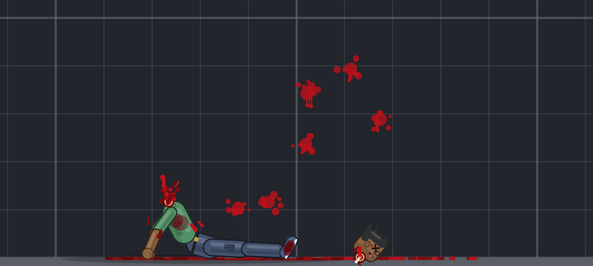
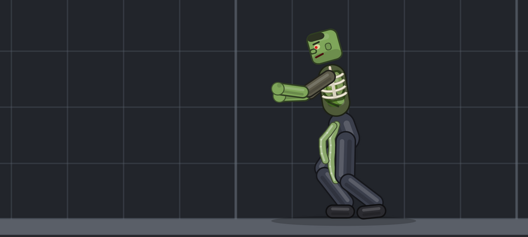

## Novedades de Trastazo Playground Unity 1.8

* **Portada nueva:** la pantalla de inicio es ahora un póster del juego: un foco desde el techo y, debajo,
  una escena en vivo: Billy en su triciclo, un hombre con la **trampa invertida** y su cuenta atrás, un
  **cepo**, un **péndulo** que se pone en marcha, una lámina de cristal, un barril rojo y un zombi. Los
  personajes posan quietos unos segundos y luego empieza el espectáculo. Las novedades pasan a una línea
  roja abajo para no tapar la escena. **Icono nuevo** de la app (T sobre fondo oscuro con sangre y «PLAYGROUND»).

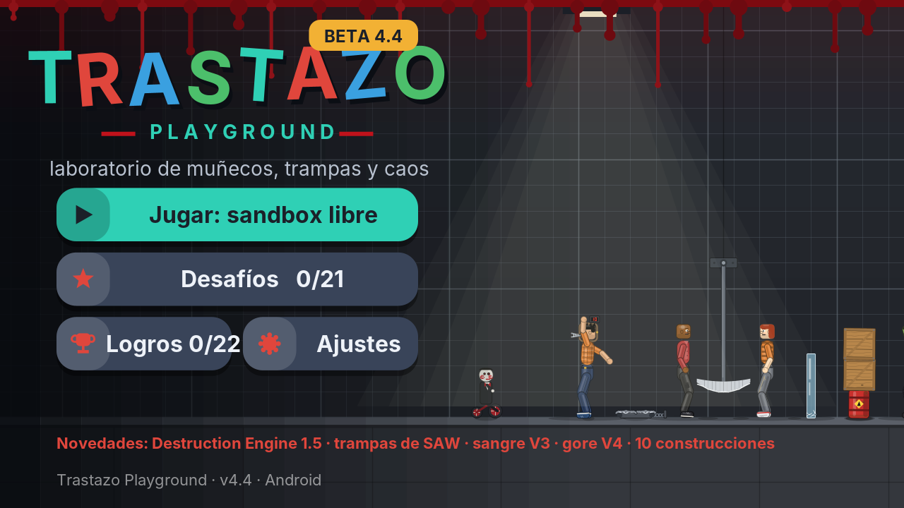
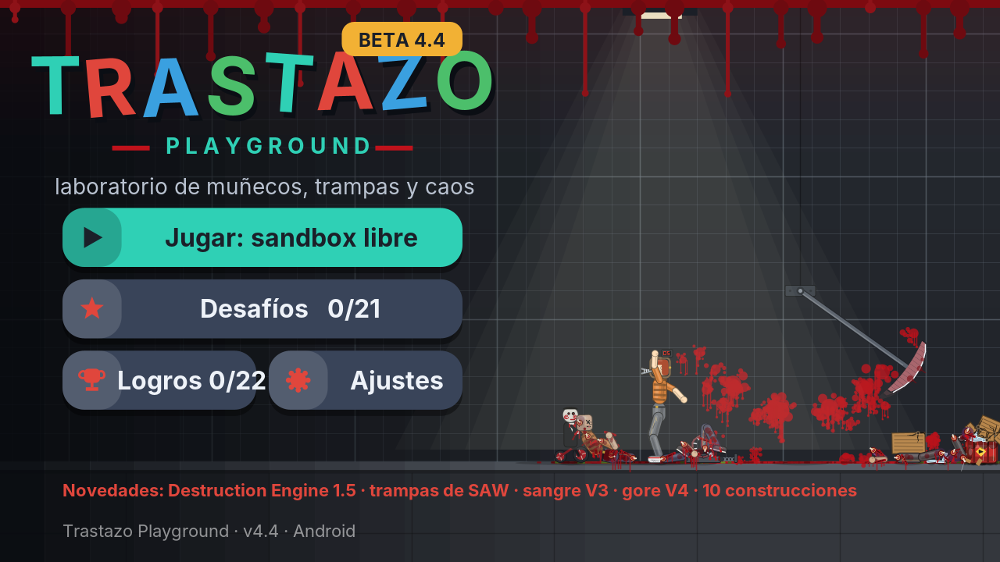

## Novedades de Trastazo Playground Unity 1.7

* **Nuevo nombre: Trastazo Playground** (menú, nombre del producto en Unity, informe de errores). Los datos
  guardados siguen siendo compatibles.

## Novedades de Trastazo Unity 1.6

* **Más construcciones** (categoría *Construir*, ahora 10): **Pirámide** (28 ladrillos escalonados),
  **Castillo** (muro con dos torres y almenas), **Invernadero** (marco de acero con paredes y techo de
  cristal que se hace añicos), **Dominó** (14 fichas en fila, la primera inclinada) y **Andamio** (postes de
  acero y tablones en dos pisos). Todas aguantan solas y se derrumban con una explosión.

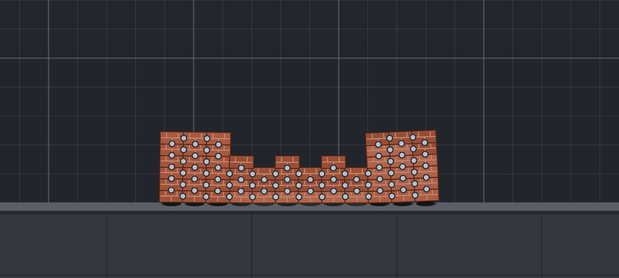
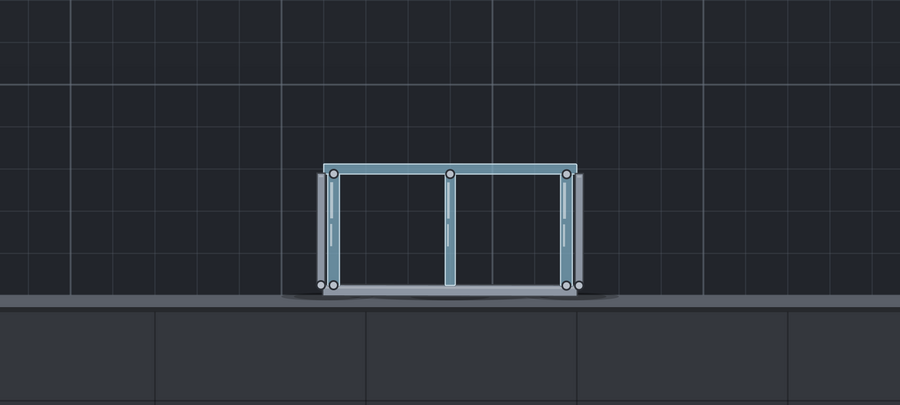

## Novedades de Trastazo Unity 1.5

* **Destruction Engine 1.5:**
  * **Cristal** (Objetos): se agrieta con cada golpe o bala y se hace **añicos** en 6-16 esquirlas finas que
    salen disparadas desde el impacto, con destellos y sonido; las esquirlas **cortan** (menos que un cuchillo)
    y no se rompen otra vez.
  * **Astillas:** los golpes fuertes arrancan astillas y trocitos del punto golpeado (no en metal).
  * **Colapsos en cadena:** cuando se suelta una unión de una construcción, las piezas vecinas cargan con más
    peso, se **agrietan y se debilitan**, y el derrumbe se extiende; nubes de polvo en cada unión.
  * **Suelo quemado:** las explosiones cerca del suelo dejan **marcas de quemadura** anchas.
  * Las esquirlas de cristal conservan el filo al guardar y cargar.

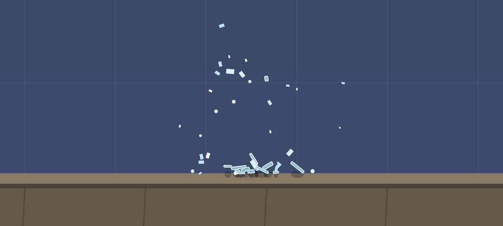
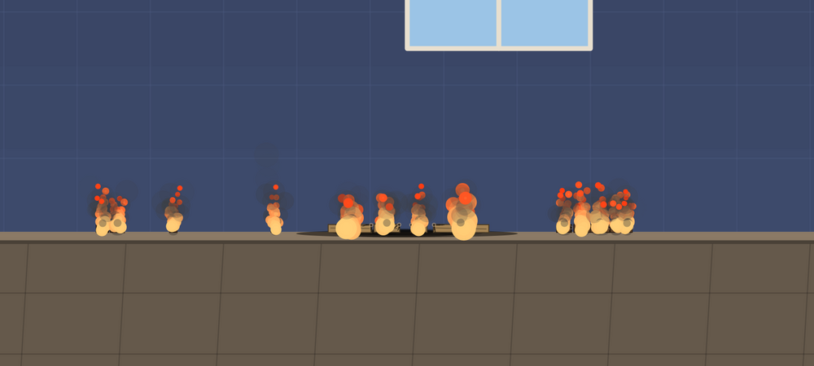

## Novedades de Trastazo Unity 1.3

* **Menú principal nuevo:** sangre que gotea desde arriba, botones con iconos, cinta *UNITY 1.3* y un
  cuadro de novedades.
* **Modelos renovados V2:** ropa por estilos (camiseta, rayas, sudadera con capucha, camisa y corbata,
  cuadros, chaqueta, camiseta estampada; vaqueros con costuras, chinos, cargo, pantalón corto), zapatillas
  con suela y cordones, orejas, nariz, ojos con pupila, cejas, barba y seis peinados (corto, largo, de punta,
  calvo, coleta, rizado). Las expresiones cambian: miedo y dolor (boca abierta), inconsciente, muerto.
* **Sangre V3:** gotas con estela, **charcos que crecen** donde cae la sangre y **se secan** (se oscurecen)
  con el tiempo, **salpicaduras en la pared** de fondo que **chorrean** hacia abajo, ropa y piel **empapadas**,
  heridas que gotean mientras sangran y el cuello cortado que bombea.
* **Gore V4:** miembros destrozados enseñan **músculo y hueso** (que se ve partido si está roto), **muñones**
  con piel, carne, grasa, hueso asomando y jirones colgando (cables en los robots), **cráneo agrietado** y
  **cerebro a la vista**, ojo morado, e **intestinos** que cuelgan y se balancean si el vientre se abre.
* **Trampas de SAW** (categoría nueva *Trampas SAW*):
  * **Cepo:** se esconde en el suelo y atrapa el pie que lo pisa (le rompe la pierna). *Activar* lo vuelve a armar.
  * **Péndulo:** una cuchilla gigante que oscila desde el techo y corta lo que encuentra; se mancha de sangre.
  * **Trampa invertida:** colócala sobre una cabeza; cuenta atrás de 12 s en su pantalla. *Activar* la quita a
    tiempo... si no, las mandíbulas se abren.
  * **Billy:** el muñeco del triciclo: pedalea, se ríe y habla («Hola. Quiero jugar a un juego.»).
* **Motor de destrucción:** cada golpe deja una **grieta** donde pega (abolladuras y arañazos en el metal);
  al romperse, la pieza se parte **alrededor del punto de impacto** en trozos de tamaños distintos (pequeños y
  rápidos cerca del golpe, grandes lejos), con astillas, polvo de ladrillo o chispas según el material.
* **Texturas nuevas:** veta y nudos en la madera de las cajas, óxido en los barriles, acero cepillado,
  ladrillos de tonos distintos; y los dibujos de la ropa de arriba.
* Sonidos nuevos (sintetizados): el chasquido metálico de las trampas y la risa de Billy.

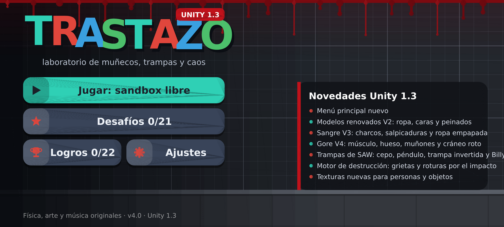
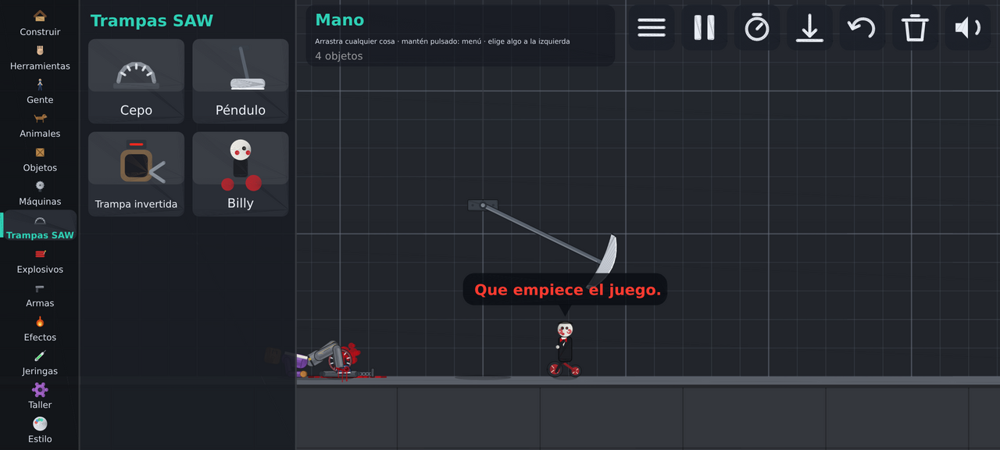
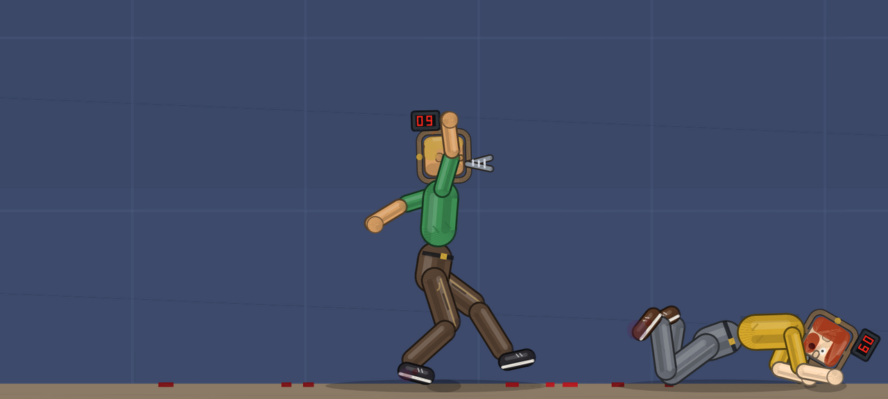
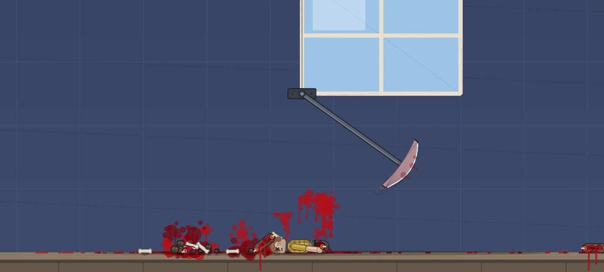
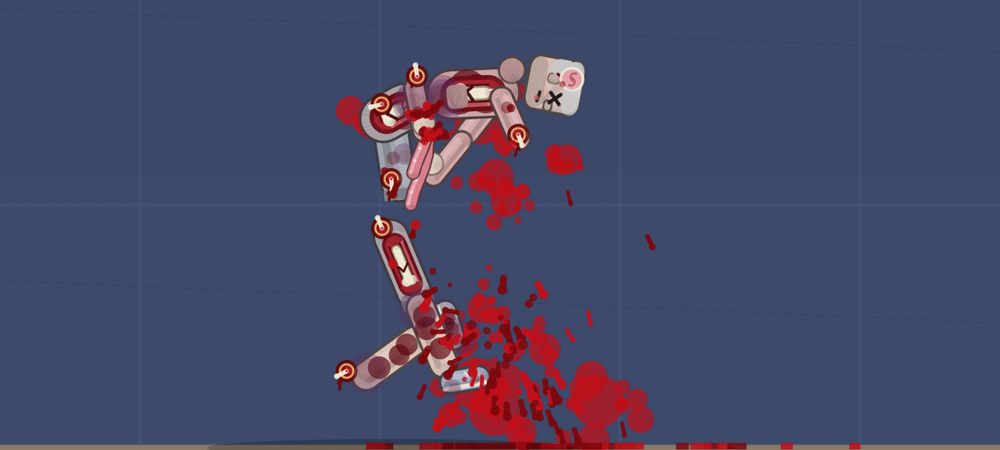
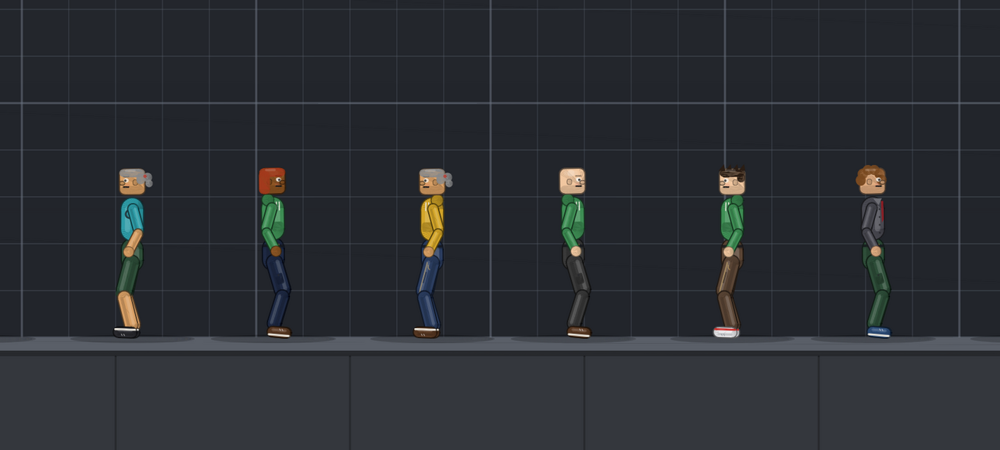

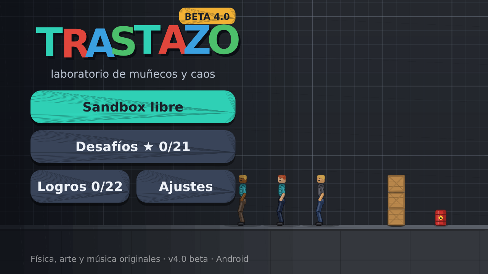
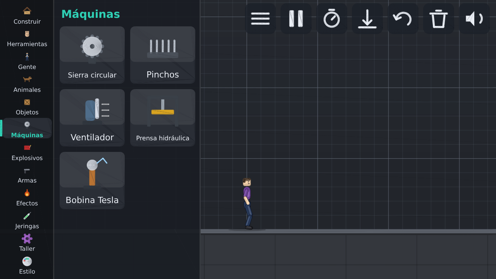

*(Capturas del juego dibujado por el mismo código de dibujo que usa Unity, volcado a SVG en las pruebas.)*

## Abrirlo

1. **Unity Hub → Add → Add project from disk** y elegir esta carpeta (`trastazo-unity`). Unity **2022.3 LTS o
   superior** (también Unity 6). Si pide actualizar el proyecto, aceptar.
2. Al abrir por primera vez se configuran solos los ajustes del jugador (nombre, orientación horizontal,
   IL2CPP/ARM64 en Android, espacio de color Gamma). También están en el menú **Trastazo → Configurar proyecto**.
3. Pulsar **Play**. No hace falta crear ninguna escena: el juego se arranca solo (`TrastazoBootstrap`) en
   cualquier escena, también en una vacía. (**Trastazo → Crear escena** crea `Assets/Scenes/Trastazo.unity`
   para las compilaciones.)

### Compilar

Menú **Trastazo → Compilar →** Android (APK) / Windows / Linux / macOS. Salen en `Builds/`. Para Android hace
falta el módulo *Android Build Support* (con SDK/NDK/OpenJDK) instalado desde Unity Hub. Desde la línea de
comandos: `Unity -batchmode -quit -projectPath . -executeMethod TrastazoUnityEditor.TrastazoEditor.BuildAndroid`.

## Controles

* **Móvil:** como la versión Android: toca y arrastra (varios dedos), botón *Atrás* = menú/pausa.
* **PC:** ratón (clic izquierdo = tocar/arrastrar, derecho o central = mover cámara, rueda = zoom o desplazar el
  catálogo), `Esc` menú, `Espacio`/`P` pausa, `S` cámara lenta, `G` gravedad, `H` mano, `1`–`9`,`0` categorías,
  `+`/`-` zoom, flechas o `WASD` mover cámara, `Ctrl+Z` deshacer, `F11` o `Alt+Enter` pantalla completa.

Los datos (autoguardado, ajustes, mods `.rpmod`, informe de errores `trastazo-informe.txt`, caché de música) están
en `Application.persistentDataPath`. El **editor de mods** del Taller es un cuadro de texto sobre el juego (IMGUI).

## Cómo está hecho

```
Assets/Trastazo/
  Core/                  C# puro (asmdef sin referencias a Unity, compila también con `dotnet`)
    Generated/           el juego, traducido de Java por tools/java2cs.py  ← no editar a mano
    Compat/JavaCompat.cs   runtime tipo Java: Math, JList, StringBuilder, Random (mismo generador), Fmt.format, File...
    Gfx/                   Canvas / Paint / Path / RectF: reciben las órdenes de dibujo y las convierten en triángulos
    Sfx.cs, MusicPlayer.cs síntesis de efectos y mezclador de la banda sonora (independientes de Unity)
    Driver.cs, Report.cs   ratón/teclado/escala, ajustes en texto, informe de errores
  Unity/                 la capa de Unity (≈ 800 líneas)
    TrastazoApp.cs         MonoBehaviour: bucle, tamaño de pantalla, ciclo de vida, guardado, vibración
    UnityCanvasRenderer.cs el fotograma (triángulos + texto) → un Mesh dibujado con una cámara ortográfica
    UnityInput.cs          toques, ratón y teclado (Input System o Input Manager clásico, el que use el proyecto)
    UnityAudio.cs          efectos con un banco de AudioSources; música en streaming (AudioClip con callback)
    ModEditor.cs           editor de mods (IMGUI)
  Resources/             dos shaders sin iluminación (TrastazoSolid, TrastazoText)
  Editor/                ajustes del proyecto y menú Trastazo
```

* **Un solo código de juego.** Java sigue siendo la fuente (`../trastazo/src`): `tools/java2cs.py` lo traduce
  a C# (tipos, `instanceof`, `foreach`, `>>>`, literales hexadecimales de 32 bits, constantes, modificadores de
  acceso, `override`...) y `Compat/JavaCompat.cs` aporta lo que Java traía de serie (el mismo generador
  aleatorio, `String.format`, listas...). Para regenerar tras tocar el Java: `tools/build_core.sh`.
* **Dibujo.** El juego pinta en un `Canvas` (el mismo código de interfaz y mundo que en Android/PC). Aquí ese
  `Canvas` no dibuja píxeles: **tesela** rectángulos, círculos, arcos, trazos y rutas en triángulos (con
  recorte y transformaciones) y deja una lista en orden de pintado (`DrawList`). `UnityCanvasRenderer` la sube
  a **un único Mesh** por fotograma, con un submesh por tramo (triángulos / texto) y una profundidad creciente
  para conservar el orden. El texto usa la fuente del sistema (`Font` dinámica) sobre quads de glifos.
  El suavizado de bordes lo hace el MSAA (se pide ×4 al arrancar; en URP actívalo en el *URP Asset*).
* **Sonido.** Los efectos se sintetizan al arrancar (las mismas fórmulas) y se reproducen con volumen y
  velocidad variables; la música se compone en segundo plano, se guarda en caché y se mezcla en un
  `AudioClip` de streaming con fundidos y la capa de «acción».

## Verificación

Todo lo siguiente se ejecuta fuera de Unity, con .NET (`tools/test_all.sh`; 8.0, C# 9 como Unity):

| Qué | Resultado |
|---|---|
| El juego traducido (28 archivos, ~12 000 líneas) compila | sí, 0 errores |
| `PhysTest` física: pilas, rodar, péndulo, músculo, soldaduras, coche | todo pasa |
| `PersonTest` ragdoll activo: se levanta, camina, corre, gira | todo pasa |
| `WorldTest`, `AiTest`, `BuildTest`, `DestroyTest`, `AnimalTest`, `Test39`, `InputTest` | todo pasa |
| `MachineTest` (sierra, pinchos, prensa, Tesla...) | pasa; 3 comprobaciones de pinchos son *intermitentes* (también en Java, dependen del azar) |
| `Test39` | pasa; «los gibs incluyen órganos» falla de vez en cuando (también en Java: a veces la explosión solo revienta brazos y piernas) |
| `Test40` (informe de errores, guardado seguro, botones en 7 tamaños) | todo pasa |
| `Test27` (2.9: fuego, polvo, mordiscos) | pasan |
| `Test26` (2.8: grúa, agujeros, armadura) | pasan |
| `Test25` (2.7: inundación, meteoritos, tormenta, EF, epicentro) | pasan |
| `Test24` (2.5: Levolution) | pasan |
| `Test23` (2.4: edificio, rascacielos, integridad estructural) | pasan |
| `Test22` (2.3: mina, guillotina, lanzallamas, láser) | pasan |
| `Test21` (2.2: sangre arterial, salpicaduras satélite, cuerpos que gotean, armas ensangrentadas, charcos) | 7/7 pasan |
| `Test20` (2.1: sangre real, heridas que se coagulan, espasmos, chorros de muñón, tos con sangre) | 10/10 pasan |
| `Test19` (2.0: barra de óxido, infección, Hombre óxido, cadena de infección, guardado, modelo V3) | 13/13 pasan |
| `Test18` (1.9: chorros arteriales, charcos, huellas, manchas, salpicaduras, costillas y corazón) | 10/10 pasan |
| `Test16` (1.6: pirámide, castillo, invernadero, dominó, andamio; derrumbe, guardado) | 13/13 pasan |
| `Test15` (1.5: cristal, esquirlas, astillas, quemaduras, colapso en cadena, guardado) | 8/8 pasan |
| `Test13` (1.3: cepo, péndulo, trampa invertida, Billy, grietas y roturas, charcos, ropa empapada, gore, ropa V2, menú) | 25/25 pasan |
| `MonkeyTest` (acciones al azar) y `SoakTest` (30 semillas × 40 s con todos los objetos) | sin excepciones ni NaN |
| Dibujo | `LayoutShot` y `CanvasDemo` generan SVG con el teselador; revisados a ojo (capturas de arriba) |
| Capa de Unity | se comprueba de tipos con `dotnet build tests/UnityLayer.csproj` (y `UnityLayerNew.csproj` para la rama del Input System) contra *stubs* de la API de Unity y el código real |

Lo que **no** está verificado y es lo primero que hay que mirar en Unity: que los shaders compilen en tu
pipeline (probados solo «sobre el papel»; hay *fallback* a `Sprites/Default`), la orientación de los glifos
(`UnityCanvasRenderer.DetectGlyphOrientation` la detecta sola), que el orden de pintado por profundidad se
respete en tu versión/pipeline, el rendimiento en móviles de gama baja y el audio en streaming.

## Diferencias con Android / PC

* No existe el motor «GPU (OpenGL ES)»: Unity ya agrupa el dibujo. Se usa siempre la ruta *Canvas* (la misma
  que el motor de reserva de Android), así que **no hay luces ni destellos por GPU**.
* Un `float` fuera de rango o `NaN` convertido a `int` no da el mismo valor en C# que en Java; el bucle del
  juego sigue protegido por el mismo `try/catch` que registra el error y sigue jugando.
* La vibración usa JNI en Android (`Vibrator`); en el resto, nada.

## Pruebas y herramientas

```
tools/java2cs.py         traductor Java → C#            (python3 tools/java2cs.py ../trastazo/src/com/frameboost/ragdoll Assets/Trastazo/Core/Generated)
tools/build_core.sh      traduce y compila el núcleo con dotnet
tools/test_all.sh        traduce juego y pruebas, compila las pruebas
tools/run_tests.sh            corre toda la batería; o una a una: dotnet /tmp/trz-cs-tests/Tests.dll PhysTest (también PersonTest WorldTest AiTest BuildTest DestroyTest
                                                    AnimalTest MachineTest Test39 Test40 InputTest MonkeyTest
                                                    SoakTest LayoutShot CanvasDemo; las que guardan imágenes
                                                    reciben una carpeta como argumento y escriben SVG)
```
