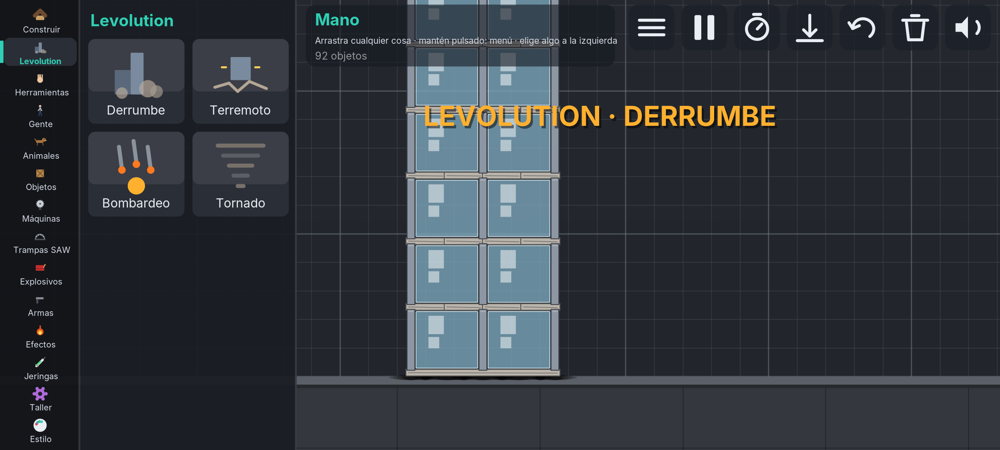
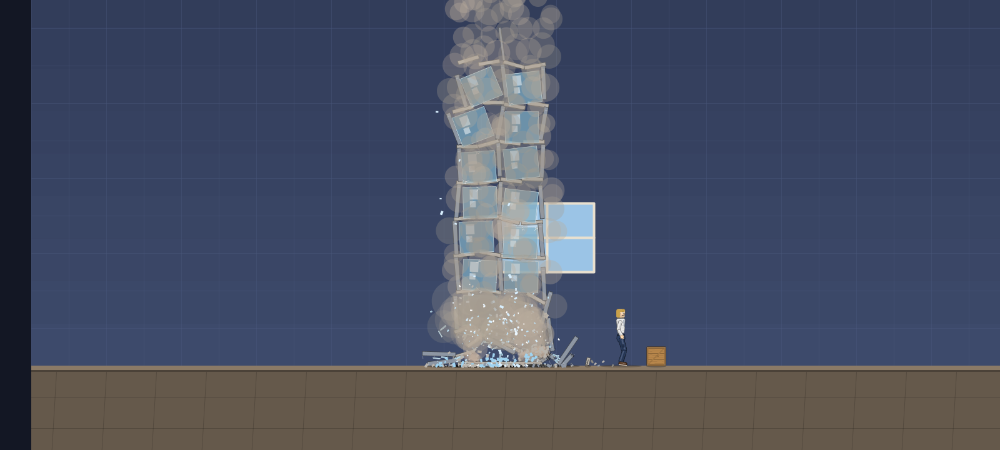
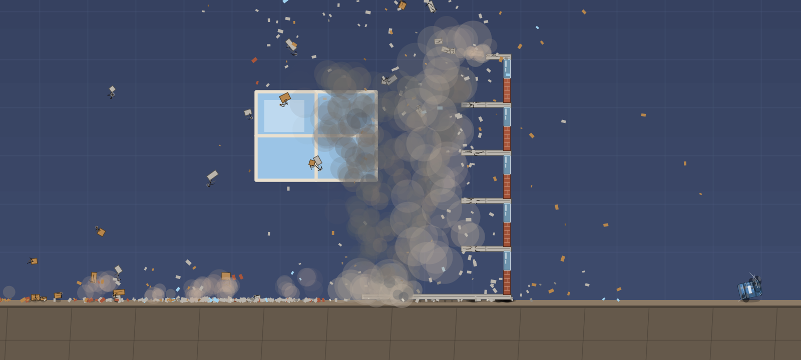
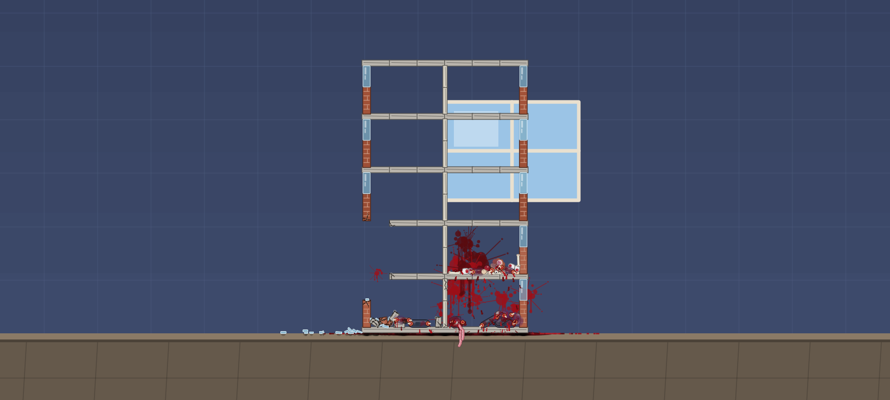
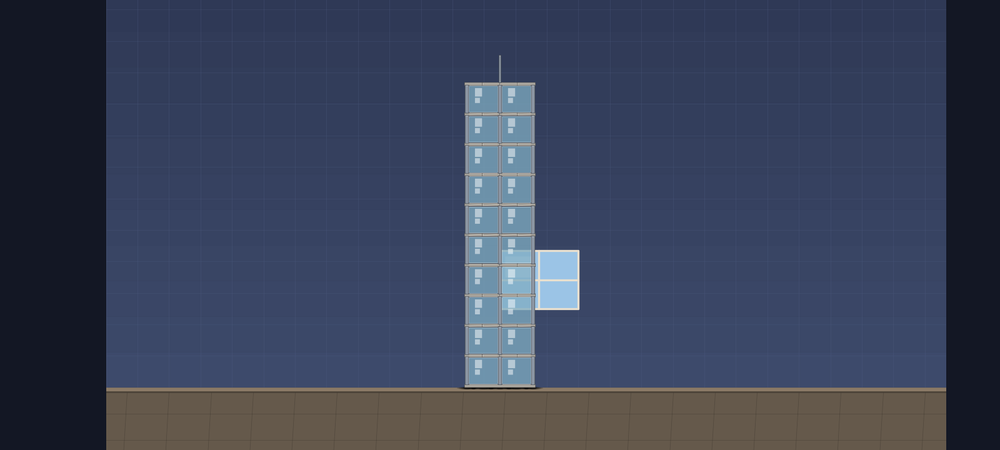
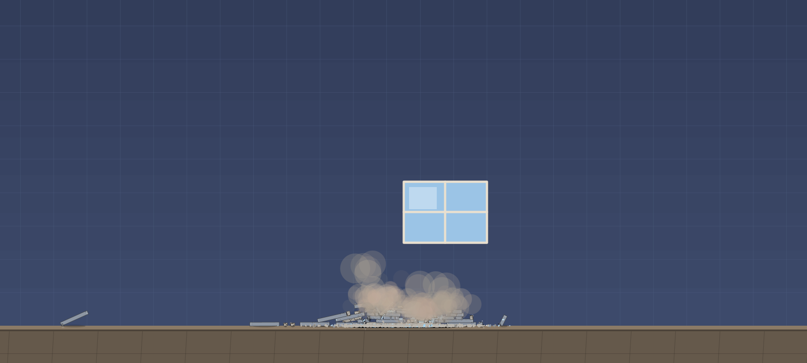
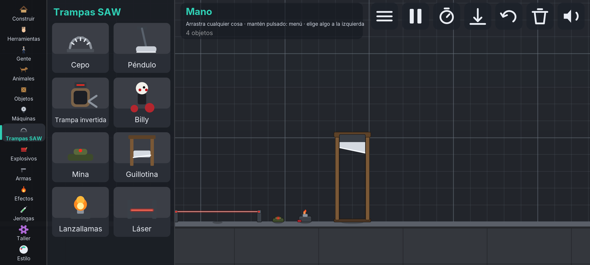
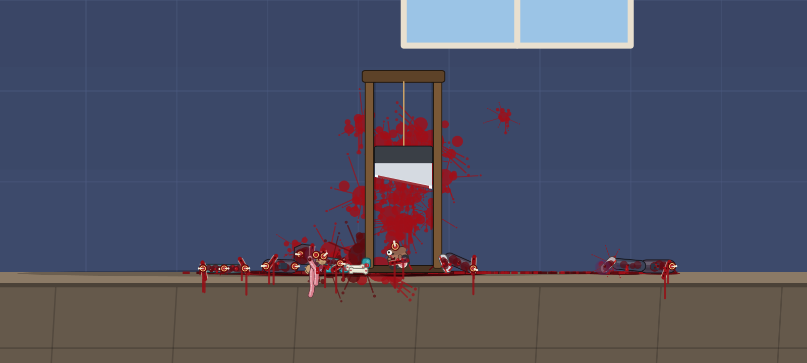
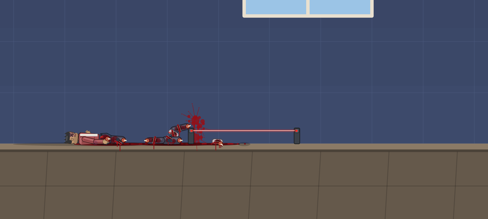

# Trastazo Playground 5.2

**Trastazo Playground** (antes *Trastazo*): laboratorio de muñecos, trampas y caos para Android. La 3.3 es un juego nuevo: el motor de física, los personajes,
la IA y el mundo se han escrito otra vez desde una hoja en blanco. Sigue siendo código propio en Java, sin
motores ni assets externos (el APK pesa ~200 KB).

**PC (Windows, Linux, macOS):** [`dist/trastazo-pc.zip`](dist/trastazo-pc.zip) — descomprimir y abrir `Trastazo.bat` (o `java -jar Trastazo.jar`). Necesita Java 8 o superior ([adoptium.net](https://adoptium.net)).

**Unity 2.5:** el mismo juego como proyecto de Unity (Android, Windows, Linux, macOS) en [`../trastazo-unity`](../trastazo-unity/README.md), con menú nuevo, trampas de SAW, sangre V3, gore V4 y motor de destrucción (lo mismo que trae el APK 4.3).

APK listo para instalar: [`dist/trastazo.apk`](dist/trastazo.apk) (Android 5.0+, pantalla horizontal; se instala
encima de las versiones anteriores).

## Novedades de la 5.2

* **Levolution** (pestaña nueva, inspirada en el Levolution de Battlefield): eventos enormes que cambian el mapa, con
  título grande en pantalla. Se eligen y se tocan en la escena:
  * **Derrumbe:** toca junto a un Edificio o Rascacielos: suena el aviso, se colocan cargas una a una en los pilares y
    muros de la planta baja y el edificio entero se viene abajo; al caer rueda por el suelo una **ola de polvo** que empuja
    todo lo que hay cerca.
  * **Terremoto:** 8 s de temblor: la pantalla vibra, todo salta, los edificios se agrietan y pierden piezas.
  * **Bombardeo:** una lluvia de 16 misiles sobre la zona; la gente huye.
  * **Tornado:** un embudo de humo y escombros que recorre la sala 16 s, arranca lo que pilla, destroza edificios y lanza
    rayos.





## Novedades de la 5.1

* **Edificio** (5 plantas) y **Rascacielos** (10 plantas, con mástil) en *Construir*. Cada planta tiene forjado de hormigón,
  muros de ladrillo con ventana, tabiques de yeso (el edificio) o columnas de acero y paneles de cristal (el rascacielos).
* **Destrucción tipo The Finals:**
  * **Todo se rompe por trozos:** los forjados están cortados en secciones y los muros en paneles; una explosión
    **abre un agujero** donde cae y deja el resto en pie. También se dañan con disparos, golpes y cascotes.
  * **Integridad estructural:** una pieza solo se sostiene mientras esté unida a la cimentación a través de otras piezas
    en pie. Lo que se queda sin apoyo **se suelta y cae** (con retraso escalonado, de abajo arriba), y un forjado no
    puede quedar en voladizo más de dos secciones. Si vuelas la planta baja, **cae todo el edificio**.
  * **Polvo:** cada pieza que se rompe o se suelta levanta **nubes de polvo** pesadas que flotan y se disipan despacio.
  * Los edificios no gastan física mientras están intactos (sus piezas están quietas hasta que pierden apoyo) y se
    guardan y cargan con la escena.





## Novedades de la 5.0

* **Más trampas** (categoría *Trampas SAW*, ahora 8):
  * **Mina:** enterrada en el suelo; al pisarla suena un *clic* y, una fracción de segundo después, explota
    (con cadena a otros explosivos). *Activar* la detona a distancia.
  * **Guillotina:** un marco de madera con una cuchilla inclinada. Cae sola sobre quien pasa por debajo, le
    corta lo que pille (la cabeza casi siempre) y se vuelve a izar lentamente. *Activar* la suelta a mano.
  * **Lanzallamas:** boquilla en el suelo con llama piloto que escupe **ráfagas de fuego** hacia arriba:
    prende a personas, animales y objetos inflamables. *Activar* la enciende/apaga.
  * **Láser:** dos postes y un rayo rojo a la altura de las espinillas que **corta las piernas** de quien lo
    cruza. *Activar* lo enciende/apaga.
  * La gente con cabeza evita lanzallamas, láseres y guillotinas encendidos.





## Novedades de la 4.9

* **Sangre V6 (remake, más realista):**
  * **Sangre arterial vs. venosa:** los chorros del cuello y de los muñones son de un rojo vivo y más rápidos;
    la que rezuma de heridas normales es oscura y espesa.
  * **Gotas y salpicaduras:** las gotas brillan al volar y, si caen rápido, **se rompen en gotitas satélite**
    que rebotan hacia arriba al chocar con el suelo.
  * **Cuerpos que gotean:** lo que empapa la ropa y la piel **gotea** desde las partes más bajas, gota a gota,
    hacia los charcos (y el cuerpo se va «secando»).
  * **Charcos con estructura:** borde que se seca primero (línea oscura), centro que **se coagula** en gelatina
    oscura y, pasado más de un minuto, **grietas** de sangre seca.
  * **Pared:** las manchas ya no son redondas: **estrías finas** salen disparadas con gotitas en las puntas,
    además de los satélites y los chorretones.
  * **Armas ensangrentadas:** cuchillos y espadas (y la sierra y las trampas) que cortan carne quedan
    **mojados de sangre** desde la punta hacia atrás.

## Novedades de la 4.8

* **Gore V6 (más realista):**
  * **Sangre real:** rojo más oscuro y menos saturado (arterial vs. venosa), y una **fina niebla de gotitas**
    cuando el golpe es fuerte.
  * **Palidez:** quien pierde sangre se queda **pálido** (hasta un 50 %); los muertos se ponen **gris
    azulados** con los minutos.
  * **Heridas que se coagulan:** una herida fresca es roja, húmeda y brillante; en ~45 s se **seca y se
    oscurece**, y deja de gotear. Los cortes muestran la **piel doblada** en los bordes y los agujeros de bala
    un **anillo oscuro** de abrasión. Los **moratones** cambian de color con el tiempo: morado → azul → verde
    amarillento.
  * **Espasmos de agonía:** al morir, el cuerpo se **convulsiona** ~1,5 s y se queda quieto.
  * **Muñones a presión:** un miembro arrancado a alguien vivo **escupe chorros al ritmo del corazón**.
  * **Sangre en la boca:** un pecho destrozado hace **toser sangre**, que mancha la cara y gotea por la barbilla.
  * **Trozos más creíbles:** fibras musculares y borde de grasa en la carne, y **médula** roja en los extremos de
    los huesos.
  * Con el gore apagado, nada de esto aparece (salvo la palidez).
* **Hombre óxido:** ya no ataca a los infectados (se unirán a él) y la infección por zarpazo sube al 70 %.

## Novedades de la 4.7

* **Hombre óxido y Barra de óxido:**
  * **Barra de óxido** (categoría *Máquinas*): una barra corroída. **Quien la toque se infecta**: el óxido se
    extiende por su cuerpo en manchas naranjas durante 7 s y, **al completarse, se convierte en Hombre óxido**
    (reaparece con la vida llena). *Activar* la apaga. Los esqueletos y los muertos son inmunes.
  * **Hombre óxido** (categoría *Gente*, también se puede colocar directamente): piel de metal corroído, cresta
    de pinchos, púas en los hombros, placa remachada con grietas incandescentes, ojos encendidos y **garras de
    acero**. Caza a todo el que esté vivo (zombis incluidos): cada zarpazo hace cortes profundos y a veces
    arranca un miembro; **mata o infecta de óxido** (70 %), y los infectados se convierten en nuevos Hombres
    óxido. Sangra naranja y aguanta casi el doble. Se guarda y se carga con la infección en curso.
* **Modelo de humanos renovado (V3):** torso con hombros y cintura, caderas, cuello, **cabeza con mandíbula**
  (cráneo ancho sobre mandíbula más estrecha), **manos con dedos y pulgar**, hombros con luz y sombra. Las
  heridas y la sangre se siguen viendo encima.

## Novedades de la 4.6

* **Sangre V3 + Gore V5:**
  * **Arterias:** un cuello cortado bombea **chorros al ritmo del corazón** que salen en arco hacia delante y
    arriba y **salpican la pared** del fondo; las extremidades arrancadas **sangran mientras vuelan**.
  * **Charcos bajo los cuerpos:** un cadáver que sigue sangrando extiende un charco (elipse que se
    engrosa y se oscurece al secarse).
  * **Huellas de sangre:** quien pisa un charco se empapa los pies y deja **huellas** al andar.
  * **Manchas:** los trozos de carne que se deslizan por el suelo dejan un rastro.
  * **Salpicaduras a los vecinos:** un reventón rocía la ropa de quien esté cerca.
  * **Costillas, pulmones y corazón:** un pecho destrozado enseña las costillas, el esternón, los pulmones, la
    tráquea, los vasos y un **corazón que late** mientras vive.
  * **Ojo colgando:** con el cráneo aplastado, un ojo salta y cuelga de su nervio.

## Novedades de la 4.5

* **Portada nueva:** la pantalla de inicio es ahora un póster del juego: un foco desde el techo y, debajo,
  una escena en vivo: Billy en su triciclo, un hombre con la **trampa invertida** y su cuenta atrás, un
  **cepo**, un **péndulo** que se pone en marcha, una lámina de cristal, un barril rojo y un zombi. Los
  personajes posan quietos unos segundos y luego empieza el espectáculo. Las novedades pasan a una línea
  roja abajo para no tapar la escena. **Icono nuevo** de la app (T sobre fondo oscuro con sangre y «PLAYGROUND»).

## Novedades de la 4.4

* **Nuevo nombre: Trastazo Playground.** En el menú (logo con «PLAYGROUND»), el nombre de la app en Android, la
  ventana de PC, Unity y el informe de errores. Las partidas guardadas y las carpetas de datos no cambian.

## Novedades de la 4.3

* **Más construcciones** (categoría *Construir*, ahora 10): **Pirámide** (28 ladrillos escalonados),
  **Castillo** (muro con dos torres y almenas), **Invernadero** (marco de acero con paredes y techo de
  cristal que se hace añicos), **Dominó** (14 fichas en fila, la primera inclinada) y **Andamio** (postes de
  acero y tablones en dos pisos). Todas aguantan solas y se derrumban con una explosión.

## Novedades de la 4.2 (Destruction Engine 1.5)

* **Destruction Engine 1.5:**
  * **Cristal** (Objetos): se agrieta con cada golpe o bala y se hace **añicos** en 6-16 esquirlas finas que
    salen disparadas desde el impacto, con destellos y sonido; las esquirlas **cortan** (menos que un cuchillo)
    y no se rompen otra vez.
  * **Astillas:** los golpes fuertes arrancan astillas y trocitos del punto golpeado (no en metal).
  * **Colapsos en cadena:** cuando se suelta una unión de una construcción, las piezas vecinas cargan con más
    peso, se **agrietan y se debilitan**, y el derrumbe se extiende; nubes de polvo en cada unión.
  * **Suelo quemado:** las explosiones cerca del suelo dejan **marcas de quemadura** anchas.
  * Las esquirlas de cristal conservan el filo al guardar y cargar.

## Novedades de la 4.1 (lo de Trastazo Unity 1.3, ahora en Android)

* **Menú principal nuevo:** sangre que gotea, botones con iconos y un cuadro de novedades.
* **Trampas de SAW** (categoría *Trampas SAW*): **cepo** que atrapa el pie que lo pisa, **péndulo** con una
  cuchilla gigante, **trampa invertida** con cuenta atrás de 12 s (*Activar* la quita a tiempo) y **Billy** en
  su triciclo («Hola. Quiero jugar a un juego.»).
* **Sangre V3:** charcos que crecen y se secan, salpicaduras en la pared que chorrean, ropa empapada, heridas
  que gotean.
* **Gore V4:** músculo y hueso a la vista, muñones con hueso y jirones, cráneo roto y cerebro, intestinos.
* **Modelos V2:** ropa por estilos, zapatillas, caras con ojos, cejas, nariz y expresiones, seis peinados.
* **Motor de destrucción:** grietas donde pegan los golpes y roturas en trozos alrededor del impacto.
* **Texturas nuevas:** madera con veta, barriles oxidados, acero cepillado, ladrillos de varios tonos.

## Novedades de la 4.0 beta (pulido)

* **Más robusto:** un fallo dentro de la simulación ya no cierra el juego (se registra, y si se repite se
  limpia el escenario); **informe de errores** en un archivo de texto (`trastazo-informe.txt`) con versión,
  dispositivo y pila de llamadas, y un aviso en la pantalla de inicio si el juego se cerró la última vez;
  **guardado seguro** (se escribe a un archivo temporal antes de sustituir la partida).
* **Interfaz:** los botones de arriba a la derecha se reducen en pantallas estrechas en vez de quedar tapados
  por el catálogo (el cuadro con el nombre de la herramienta cede el sitio); etiqueta *BETA* en el inicio.
* **PC:** el juego se pausa solo al perder el foco de la ventana.
* **Armas:** las armas sueltas ya no se dibujan boca abajo al apuntar a la izquierda.
* Pruebas de estrés con acciones al azar sobre todos los objetos (sin valores NaN ni excepciones) y de la
  disposición de la interfaz en 7 tamaños de pantalla.
* **`BETA.md`:** guía para probadores (qué mirar, dónde está el informe de errores, qué no está probado).

## Novedades de la 3.9

* **Refrigerador** (Objetos): trae una persona **congelada dentro**. Con *Activar* la puerta se abre, sale
  niebla fría y la estatua de hielo se cae hacia fuera; se descongela sola a los 40 s, o se hace añicos si la
  golpeas fuerte. Se guarda y se carga con la partida. Algunos civiles curiosos lo abren por su cuenta.
* **Gibs mejorados:** al reventar una parte salen trozos de carne con el interior en carne viva (verde en
  zombis), **huesos** (costillas, astillas de cráneo, canillas), **órganos** (corazón, pulmón, cerebro) y
  placas y engranajes en los robots; una niebla de sangre en todas direcciones; los trozos **dejan rastro de
  gotas** al volar y salpican al chocar. Los gibs de hielo salen azulados.
* **IA mejorada:**
  * **Esquivan peligros:** se detienen y dan la vuelta ante sierras, prensas y bobinas Tesla encendidas y
    ante los pinchos (los zombis no tienen miedo).
  * **Saltan obstáculos bajos** (cajas, tablas...) cuando caminan o cazan; si son muy altos, dan la vuelta.
  * **Pánico:** los civiles cercanos a una explosión, a un desmembramiento o a un cuerpo reventado huyen
    durante unos segundos, lejos del lugar.
  * **Curiosidad:** algunos se acercan a mirar un cadáver o a abrir un refrigerador.
* Logro nuevo *Sorpresa congelada*.

## Novedades de la 3.8

Más cosas al estilo People Playground:

* **Categoría Máquinas** (fijas en su sitio; *Activar* las enciende y apaga):
  * **Sierra circular:** el disco gira y corta lo que toca: heridas, sangre, chispas y amputaciones; también
    destroza cajas y tablas.
  * **Pinchos:** quien cae encima con fuerza **se queda clavado** (sangra, forcejea). Un tirón fuerte con la
    mano lo suelta.
  * **Ventilador:** sopla hacia donde mira; las pelotas salen volando y a la gente la empuja y tumba.
  * **Prensa hidráulica:** la placa baja de golpe y sube despacio; lo que queda debajo contra el suelo se
    **aplasta** (personas, animales, sandías, cajas...). El acero y lo muy pesado la frenan.
  * **Bobina Tesla:** lanza rayos a lo que se acerca: **electrocuta** (sacudidas, quemaduras, KO), detona
    explosivos y avería máquinas.
* **Nitrógeno líquido** (jeringa): la persona se **congela**, queda rígida y azulada; se descongela sola (o con
  fuego). Un golpe fuerte, una caída o un balazo la **hace añicos** en trozos de hielo.
* **Bate y martillo** (Armas) para golpear agarrándolos con la mano.
* Logros nuevos *Brocheta* y *Cubito de hielo*.

## Novedades de la 3.7: versión PC

* **El mismo juego en una ventana de escritorio**: misma física, IA, animales, construcciones, desafíos, logros,
  mods y música. El código del juego es el mismo que en Android; solo cambian el dibujo (Java2D), el sonido
  (Java Sound, con mezclador propio para los efectos) y la entrada (ratón y teclado).
* **Controles:** clic izquierdo = dedo (tocar y arrastrar; mantener = menú del objeto), clic derecho o
  central = mover la cámara, rueda = zoom (sobre el catálogo, desplazar), 1-9/0 = categorías, Espacio/P =
  pausa, S = cámara lenta, G = gravedad, Ctrl+Z = deshacer, H = soltar la herramienta, flechas/A/D/W y +/- =
  cámara, Esc = volver/menú, F11 o Alt+Enter = pantalla completa (también en Ajustes).
* La interfaz se escala con la ventana y la **resolución de dibujo se ajusta sola** si el PC va justo, para
  mantener la fluidez.
* Partidas, ajustes y mods en `%APPDATA%\Trastazo` (Windows) o `~/.trastazo` (Linux/macOS).
* Se compila con `pc/build.sh` (solo necesita un JDK); `pc/test/PcSmoke.java` prueba la ventana real con
  ratón y teclado simulados.

## Novedades de la 3.6

* **La mano ya no es una herramienta:** como en el original, siempre está activa. Elijas lo que elijas en el
  catálogo, arrastrar algo con el dedo lo agarra; tocar sin arrastrar usa la herramienta elegida (colocar,
  disparar, inyectar...); mantener pulsado abre el menú del objeto. Tocar otra vez la carta elegida la
  deselecciona. Borrar, Cortar, Fuego y Rifle siguen usando el arrastre para sí mismos.
* **Animales (nueva categoría):** perro, cerdo y rata. Pasean, se caen y se levantan; el perro ladra a zombis
  y matones, el cerdo y la rata huyen. **Se comen los cadáveres pieza a pieza** (con mordiscos, sangre y algún
  hueso que dejan tirado) y unos segundos después **hacen caca**, que huele (humo verde) y se aplasta si la
  pisas o le disparas. Se les puede herir, matar o reventar. También hay *Caca* colocable.
* **Remodelado de armas y objetos:** pistola, rifle con mira y culata de madera, ametralladora de tres
  cañones, cuchillo y espada con hoja afilada, cajas con tablas y refuerzo, barriles con aros, TNT en
  cartuchos con temporizador, granada, C4, ruedas, propulsor, viga de acero y plataforma con franjas. Los
  soldados llevan el mismo rifle nuevo.
* Sonidos nuevos (ladrido/gruñido/chillido, mordisco, pedo) y logro *Ciclo de la vida*.

## Novedades de la 3.5

* **Destrucción estilo sandbox:**
  * **Heridas visibles** en cada parte del cuerpo: agujeros de bala, cortes de armas afiladas, quemaduras de
    explosión y moratones de golpes, pegados a la pieza y girando con ella. Las partes dañadas se enrojecen
    (o se ennegrecen en robots). La jeringa de curación las cierra.
  * **Gibs:** una explosión a quemarropa, una bala pesada en la cabeza o un golpe brutal revientan la parte en
    trozos físicos (carne, metal o hueso según el personaje) que rebotan por la sala. Con la sangre
    desactivada los trozos salen del color de la ropa/piel. Sin cabeza, torso o pelvis no hay resurrección.
  * **Objetos que se rompen:** cajas, tablas y bloques de construcción acumulan daño (balas, golpes, explosiones),
    se agrietan y se parten en fragmentos más pequeños, que a su vez pueden romperse hasta quedar en astillas.
    Los ladrillos aguantan más que la madera y el acero mucho más. Hay un límite de 90 trozos en la sala.
* **Remodelado:** cuerpos con contorno oscuro, relleno plano, borde iluminado y sombra; cabezas cuadradas con
  pelo en bloque; bloques con textura de ladrillo, madera o acero; nuevo fondo **Sandbox** (sala oscura con
  cuadrícula), que es el fondo por defecto.
* **Interfaz como un sandbox de PC:** barra de categorías a la izquierda y catálogo de objetos en cuadrícula
  de dos columnas al lado, con desplazamiento vertical. Al elegir algo el catálogo se cierra solo. En los
  desafíos se mantiene la barra de herramientas abajo.
* Logros nuevos *Carnicero* y *Escombros*; corregido el orden de los logros (en la 3.4 reanimar mostraba
  *Demoledor*).

## Novedades de la 3.4

* **Construir (pestaña primera):** casa, puente, torre de ladrillos, muro y coche ya montados. Un toque
  coloca la construcción entera. El coche arranca solo.
* **Destrucción de verdad:** cada construcción son bloques unidos por soldaduras con fuerza de rotura. Un
  golpe fuerte o una explosión las rompe, y las piezas caen y se separan. Una persona que cae sobre una casa
  no la derriba; una caja pesada o una explosión sí. Logro *Demoledor* (10 uniones rotas).
* **Interfaz:** la pestaña de construcciones es la primera y el juego arranca con ella a mano.

## Novedades de la 3.3

## Qué hay de nuevo respecto a la 3.2

* **Motor de física de cuerpos rígidos propio** (`Sim`, `RB`, `Shape`, `Joint`): círculos, cápsulas y cajas,
  contactos persistentes con *warm starting*, articulaciones con límites, **músculos PD**, motores de velocidad,
  uniones soldadas y rotas por fuerza, pasos fijos de 120 Hz. Las pilas de cajas se sostienen, las ruedas ruedan
  de verdad y los coches se mueven con motores reales.
* **Ragdolls activos de 13 piezas y 12 articulaciones** (`Person`): se mantienen en pie con un titiritero
  suave, andan y corren con una marcha cinemática (IK de dos eslabones), se giran, caen, quedan KO y **se
  levantan solos**. Cada pieza tiene su propia vida: fracturas, hemorragias, amputaciones por fuerza o por corte.
* **IA programada** (`Mind`): civiles que huyen de zombis, matones, explosivos encendidos y fuego; zombis que
  cazan y contagian; **soldados** que apuntan con el brazo de verdad y solo disparan cuando el arma apunta al
  objetivo y no hay un civil en la línea; **médicos** que curan y hacen RCP; **bomberos** que apagan con manguera;
  **matones** que buscan pelea; **torretas** con servo y mira láser; **drones** con control de vuelo.
* **Mundo** (`World`): daño por velocidad de impacto, sangre, fuego que se propaga, explosiones con onda
  de choque, balas con perforación, cohetes, rayos, jeringas (curar, adrenalina, resucitar, virus, ácido, sedante).
* **Cuerdas** como cadenas de cápsulas, **soldar**, **eje** (con ruedas motor), **cortar**, **clavar**, C4 remoto,
  armas como objeto (se sueldan a un coche o a una mesa), menú contextual con pulsación larga, inspector.
* Guardado de escena completo (poses, estado, uniones), Taller de mods, 7 desafíos, 15 logros, 6 fondos.

## Cómo se juega

| Gesto | Efecto |
|---|---|
| Barra inferior | Categorías: Herramientas, Gente, Objetos, Explosivos, Armas, Efectos, Jeringas, Taller, Estilo |
| Tocar una tarjeta | Elige el objeto/herramienta |
| Mano + arrastrar algo | Agarra y lanza personas y objetos |
| Mano + mantener pulsado | Menú: Activar, Inspeccionar, Duplicar, Clavar, Borrar |
| Dos dedos / arrastrar el fondo | Zoom y cámara |
| Objeto elegido + tocar | Lo coloca |
| Cortar / Borrar / Fuego | Desliza sobre las cosas |
| Cuerda / Soldar / Eje | Toca dos piezas (o el aire) |

## Estructura

```
src/com/frameboost/ragdoll/
  Sim, RB, Shape, Joint      física de cuerpos rígidos
  Person, Mind               ragdoll activo + IA
  World, Prop, Ent           mundo, objetos, daño, fuego, explosiones
  Game, Ui, Screens          entrada, herramientas, menús
  Renderer, Fx, Draw2D …     dibujo (motor GPU OpenGL ES 2.0 o Canvas), partículas
  Music, MusicPlayer, Sfx    banda sonora y efectos generados por código
```

## Compilar y probar

```
./build.sh                     # APK sin SDK: aapt + javac + dx + zipalign + apksigner
test/fetch-lwjgl.sh            # (una vez) bibliotecas para las pruebas de GPU
MAIN=PhysTest   test/run.sh    # motor de física
MAIN=InputTest  test/run.sh /tmp/shots
MAIN=AiTest     test/run.sh /tmp/shots   # comportamiento de la IA
MAIN=MonkeyTest test/run.sh 6            # juego aleatorio
MAIN=GLStress   test/run.sh /tmp/shots   # motor GPU con Mesa llvmpipe
```
